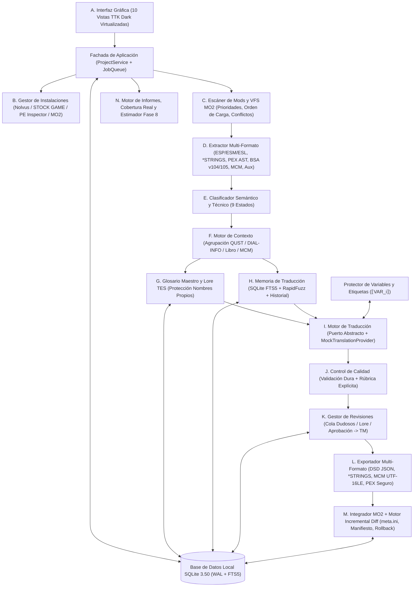

> **ARQUITECTURA BASE — INSTANTÁNEA DE FASES 0–6:** Este documento registra el diseño inicial del sistema. Puede contener nombres de módulos, rutas, tablas o funciones que hayan cambiado desde su redacción. La arquitectura de proveedores y el estado actual se consolidan en la documentación de Fase 10 y [CURRENT_PROJECT_STATE.md](../documentacion/HISTORICO.md). Verifica siempre el código fuente actual antes de implementar a partir de este diseño.

---

# Arquitectura del Sistema — NOLVUS AI TRANSLATOR

## 1. Visión General y Principios Rectores

**NOLVUS AI TRANSLATOR** sigue una **Arquitectura Modular por Capas y Puertos/Adaptadores (Hexagonal)** diseñada para Windows, Skyrim Anniversary Edition y el sistema de archivos virtual (VFS) de **Mod Organizer 2 (MO2)** en **Nolvus Awakening 6.0.21**.

### Principios Inquebrantables
1. **Inmutabilidad del Origen (Solo Lectura)**: `STOCK GAME`, los mods originales de Nolvus, `ModOrganizer.ini` y los perfiles principales de MO2 se abren exclusivamente en modo lectura.
2. **Independencia del Proveedor de IA**: Ningún componente del núcleo conoce detalles de una API externa; todo pasa por el puerto abstracto `TranslationProvider` (implementado actualmente mediante `MockTranslationProvider`).
3. **Integridad Binaria Determinista**: Prohibido el reemplazo binario ciego. Cada formato (`ESP/ESM/ESL`, `*STRINGS`, `PEX`, `BSA`, `MCM`) se procesa respetando su gramática estructural exacta.
4. **Cobertura Transparente**: Los formatos no procesables (ej. texto incrustado en bytecode `.swf` o texturas `.dds`) se inventarían explícitamente como `no compatibles` en lugar de ocultarse.

---

## 2. Diagrama de Componentes (A – N)



---

## 3. Estructura de Paquetes del Proyecto

```text
c:\Skyrim proyecto traducción\
├── pyproject.toml
├── launch_gui.bat
├── README.md
├── ARCHITECTURE.md
├── TECHNICAL_DECISIONS.md
├── SUPPORTED_FORMATS.md
├── COMPATIBILITY.md
├── LICENSES_AND_THIRD_PARTY.md
├── ROADMAP.md
├── TESTING.md
├── USER_GUIDE.md
├── src/
│   └── nolvus_translator/
│       ├── __init__.py
│       ├── __main__.py
│       ├── core/
│       │   ├── config.py             # Configuración validada (Pydantic)
│       │   ├── models.py             # Entidades de dominio y enumeraciones
│       │   ├── exceptions.py         # Excepciones tipadas y bloqueo de APIs de pago
│       │   ├── logging_manager.py    # Logs rotativos y registro de auditoría
│       │   ├── database.py           # Esquema SQLite 3.50 (WAL, FTS5, migraciones)
│       │   ├── pe_inspector.py       # Lector Win32 PE (SkyrimSE.exe, SKSE, DSD)
│       │   └── lz4_codec.py          # Descompresor/compresor LZ4 Frame & Block puro
│       ├── mo2/
│       │   ├── detector.py           # Detección segura de Nolvus, STOCK GAME y MO2
│       │   └── vfs.py                # Resolución VFS (modlist.txt inverso + plugins.txt)
│       ├── formats/
│       │   ├── strings_table.py      # Binarios .STRINGS, .DLSTRINGS, .ILSTRINGS (UTF-8)
│       │   ├── esp_parser.py         # Binarios .ESP, .ESM, .ESL, ESPFE (TES4, GRUP, zlib)
│       │   ├── pex_parser.py         # AST Big-Endian .PEX (36 opcodes, protección IDs)
│       │   ├── bsa_archive.py        # Lector solo lectura .BSA v104 (zlib) y v105 (LZ4)
│       │   ├── mcm_parser.py         # Interface/Translations UTF-16LE BOM + MCM Helper JSON
│       │   └── aux_parsers.py        # PSC, XML estructurado, INI localización (*_DISTR.ini)
│       ├── classification/
│       │   └── classifier.py         # Clasificador de 9 estados + heurística de idioma/código
│       ├── lore/
│       │   ├── seed_data.py          # Base de conocimiento TES V: Skyrim y reglas es-419
│       │   ├── glossary.py           # Gestor de Glosario Maestro y detección de conflictos
│       │   └── context_engine.py     # Agrupador narrativo (diálogos, misiones, libros, MCM)
│       ├── memory/
│       │   └── tm_engine.py          # Memoria persistente, similitud RapidFuzz y versiones
│       ├── quality/
│       │   ├── protector.py          # Enmascarado ⟦VAR_i⟧ y verificación estricta post-traducción
│       │   └── validator.py          # Control de calidad y puntuación explícita auditable
│       ├── translation/
│       │   ├── interfaces.py         # Interfaz TranslationProvider independiente del motor
│       │   ├── mock_provider.py      # MockTranslationProvider (lotes, fallos simulados, lore)
│       │   ├── future_stubs.py       # Adaptadores futuros bloqueados (sin llamadas externas)
│       │   └── pipeline.py           # Orquestador por lotes con checkpoints, reintentos y TM
│       ├── updates/
│       │   └── diff_engine.py        # Comparador incremental de snapshots y hashes SHA-256
│       ├── export/
│       │   ├── dsd_exporter.py       # Generador JSON Dynamic String Distributor
│       │   └── mo2_packager.py       # Constructor de mod independiente MO2, manifiesto y rollback
│       ├── reports/
│       │   ├── coverage.py           # Estadísticas reales por dominio (9 categorías / 9 estados)
│       │   └── cost_estimator.py     # Calculador local de tokens, lotes y escenarios Fase 8
│       ├── services/
│       │   └── project_service.py    # Fachada asíncrona para la GUI y operaciones reanudables
│       └── ui/
│           ├── theme.py              # Sistema visual oscuro Nordic Slate / Gold
│           └── app.py                # Aplicación de escritorio con las 10 secciones completas
└── tests/
    ├── fixtures_builder.py           # Generador determinista de binarios sintéticos de prueba
    ├── test_formats.py               # Pruebas ESP, *STRINGS, PEX AST, BSA v104/v105, MCM, XML
    ├── test_mo2_and_pe.py            # Pruebas VFS MO2, prioridades, conflictos y PE Inspector
    ├── test_lore_glossary_tm.py      # Pruebas Glosario, nombres propios, Memoria y duplicados
    ├── test_protector_and_qa.py      # Pruebas protección de variables y rechazo automático QA
    ├── test_pipeline_and_updates.py  # Pruebas MockTranslationProvider, reanudación y diff updates
    ├── test_export_and_reports.py    # Pruebas mod MO2, DSD, UTF-16LE, rollback, cobertura y tokens
    └── test_ui_smoke.py              # Prueba automatizada de instanciación de las 10 vistas GUI
```

---

## 4. Modelo de Datos Local (`SQLite 3.50` en Modo WAL)

La base de datos local almacena todo el estado del proyecto con integridad referencial y soporte de reanudación atómica:
* `projects`: Metadatos del proyecto, rutas verificadas de Nolvus/MO2, versión PE de `SkyrimSE.exe`, perfil activo e idiomas (`en -> es-419`).
* `scan_snapshots`: Instantáneas históricas de escaneo para detección incremental de actualizaciones.
* `scanned_mods`: Inventario de mods en MO2, estado activo, prioridad VFS y orden de carga.
* `scanned_files`: Inventario de archivos sueltos y empaquetados en `.bsa`, hash SHA-256, tamaño, formato, estado de soporte y mod ganador en VFS.
* `string_entries`: Todas las cadenas detectadas con su clave estructural (`plugin`, `form_id`, `record_type`, `subrecord_type`, `sub_index`), dominio de contenido, estado de clasificación, contexto narrativo (`quest_id`, `topic_id`, `speaker`), texto original, texto traducido, estado de revisión, desglose JSON de confianza y bandera `is_simulated`.
* `glossary_terms` + índice: Glosario Maestro compartido entre mods, reglas de protección de nombres propios y estado de aprobación.
* `translation_memory` + `tm_fts` (FTS5) + `tm_versions`: Memoria persistente contextualizada, índice de búsqueda rápida y auditoría completa de versiones previas.
* `translation_jobs` + `translation_batches`: Cola persistente de trabajos por lotes para reintentos automáticos y **reanudación exacta** tras interrupción.
* `export_history`: Registro de paquetes MO2 generados, rutas de backup, manifiestos SHA-256 y puntos de reversión.
