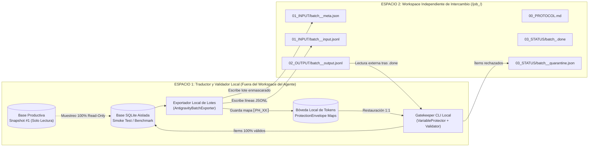

# NOLVUS AI TRANSLATOR — FASE 10.1-A: INFORME DE AUDITORÍA TÉCNICA INTEGRAL DEL CÓDIGO FUENTE Y EVALUACIÓN ARQUITECTÓNICA

- **Identificador único de auditoría:** `AUDIT-10.1A-20261103-113100`
- **Fecha y hora de ejecución (UTC):** `2026-11-03T16:31:00Z`
- **Proyecto:** Nolvus AI Translator (`v0.6.0`, esquema SQLite `v1.1.0`)
- **Objetivo del sistema:** Localización integral asistida por IA de **Nolvus Awakening 6.0.21** (*Skyrim Anniversary Edition*, runtime binario `1.5.97.0`) al **español latinoamericano neutro (`es-419`)**
- **Modalidad de auditoría:** Estática, exhaustiva y 100 % de solo lectura
- **Commit base del repositorio documental (`Antigravity-MD-Skyrim`):** `24600a3` (`main`)

---

## 1. Resumen Ejecutivo

Se ha ejecutado una auditoría técnica estática y exhaustiva sobre la totalidad del código fuente existente de **Nolvus AI Translator** (`57` archivos en el repositorio de código: `3` archivos de configuración/lanzamiento en raíz, `50` archivos Python bajo `src/nolvus_translator/` distribuidos en `13` subpaquetes y `4` archivos de pruebas automatizadas bajo `tests/`), contrastándolo línea por línea con los `10` documentos rectores publicados en la rama `main` del repositorio documental (`24600a3`).

### Conclusiones principales verificadas en código:

1. **Base funcional sólida y modular (`v0.6.0`):** El núcleo de infraestructura (`core`), detección de entorno y resolución VFS de Mod Organizer 2 (`mo2`), parsers binarios y estructurados (`formats`), clasificador determinista (`classification`), Glosario Maestro y motor de contexto (`lore`), Memoria de Traducción (`memory`), protector de variables y validador de calidad (`quality`), empaquetador no destructivo para MO2 (`export`), diferenciador entre instantáneas (`updates`), generadores de informes (`reports`) e interfaz gráfica de escritorio (`ui`) están **implementados en código real** (`8.716` líneas totales en los `57` archivos inspeccionados).
2. **Evaluación de los 23 componentes requeridos para la integración con Google Antigravity:**
   - **`5` componentes están `IMPLEMENTADO CON PRUEBAS`** y son directamente reutilizables sin rediseño: protección determinista de placeholders (`VariableProtector`), validación de etiquetas HTML/XML/Scaleform, protección de claves MCM (`$Key`) e identificadores Papyrus `.pex`, validación del Glosario Maestro, validación de neutralidad `ES-419` y bloqueo de traducciones comunitarias.
   - **`13` componentes están en estado `PARCIAL`**: existen estructuras en memoria, tablas SQLite o funciones base (como `TranslationBatchItem`, `NarrativeContextPacket`, `string_uid` determinista, hashes SHA-256 locales, `translation_batches`, `DatabaseManager` parametrizable y recuperación síncrona por lote), pero requieren adaptación para operar mediante intercambio asíncrono de archivos JSON/JSONL.
   - **`5` componentes están `AUSENTE`** en el código actual (fueron diseñados conceptualmente en la Fase 10 documental pero aún no codificados): el adaptador `AntigravityExchangeAdapter`, el receptor/colector de resultados `.jsonl`, el generador de micro-lotes de reintento para ítems en cuarentena, el `Gatekeeper CLI` ejecutable por consola, y los delimitadores/filtros anti-*prompt injection* para separar texto no confiable del juego de las instrucciones al agente.
   - **`0` componentes quedaron en estado `NO VERIFICABLE`** dentro del repositorio de código fuente, dado que el 100 % de los archivos del proyecto fue leído e inspeccionado.
3. **Verificación de seguridad arquitectónica:** Se confirma que la arquitectura de **separación física en dos espacios de trabajo** (Espacio 1: Traductor y Validador Local fuera del alcance del agente; Espacio 2: Workspace Independiente de Intercambio Antigravity) es totalmente compatible con el código actual y resuelve los riesgos de modificación accidental de código, contaminación de la base productiva y ejecución de instrucciones embebidas en textos de mods.
4. **Preservación de la vía API:** La interfaz abstracta `BaseTranslationProvider` (`src/nolvus_translator/translation/interfaces.py`) y el registro de proveedores (`src/nolvus_translator/translation/future_stubs.py`) mantienen intacta la compatibilidad futura con APIs externas, requiriendo únicamente sustituir el bloqueo estático `active_provider != "mock"` por una política de enrutamiento dual (`ProviderMode`) que habilite el modo `antigravity_exchange` manteniendo bloqueadas las APIs de pago (`PaidApiBlockedError`) mientras no exista autorización expresa.

---

## 2. Metodología de Inspección Estática

La auditoría se realizó aplicando estrictamente las reglas de seguridad de la Fase 10.1-A:

1. **Sincronización documental previa:** Se actualizó la rama `main` del clon documental (`24600a3`) y se leyeron íntegramente los `10` documentos de referencia (`README.md`, `CURRENT_PROJECT_STATE.md`, `DOCUMENTATION_POLICY.md`, `DOCUMENTATION_CLEANUP_REPORT.md` y los `6` documentos de `Fase10_Antigravity_Architecture/`).
2. **Lectura estática completa (100 % de cobertura de archivos):** Se leyeron de principio a fin los `57` archivos que conforman el repositorio fuente (`pyproject.toml`, `.gitignore`, `launch_gui.bat`, los `50` módulos e inicializadores de `src/nolvus_translator/` y los `4` archivos de `tests/`).
3. **Verificación criptográfica de integridad:** Se calcularon en modo de solo lectura el tamaño exacto en bytes, el conteo de líneas y el hash `SHA-256` de cada uno de los `57` archivos del repositorio fuente y de los `10` documentos de referencia (registrados en `inspected_file_manifest.json`).
4. **Cero ejecución y cero mutación:** No se ejecutaron pruebas automatizadas (`unittest`/`pytest`), no se instalaron paquetes, no se invocaron APIs externas y no se modificó ningún archivo del traductor, de la base de datos SQLite ni de la instalación de Nolvus/MO2.

---

## 3. Árbol Real del Proyecto

A continuación se presenta la estructura real verificada del repositorio del traductor (utilizando únicamente rutas relativas):

```text
.
├── .gitignore
├── launch_gui.bat
├── pyproject.toml
├── src/
│   └── nolvus_translator/
│       ├── __init__.py
│       ├── __main__.py
│       ├── classification/
│       │   ├── __init__.py
│       │   └── classifier.py
│       ├── core/
│       │   ├── __init__.py
│       │   ├── config.py
│       │   ├── database.py
│       │   ├── exceptions.py
│       │   ├── logging_manager.py
│       │   ├── lz4_codec.py
│       │   ├── models.py
│       │   └── pe_inspector.py
│       ├── export/
│       │   ├── __init__.py
│       │   ├── dsd_exporter.py
│       │   └── mo2_packager.py
│       ├── formats/
│       │   ├── __init__.py
│       │   ├── aux_parsers.py
│       │   ├── bsa_archive.py
│       │   ├── esp_parser.py
│       │   ├── mcm_parser.py
│       │   ├── pex_parser.py
│       │   └── strings_table.py
│       ├── lore/
│       │   ├── __init__.py
│       │   ├── context_engine.py
│       │   ├── glossary.py
│       │   └── seed_data.py
│       ├── memory/
│       │   ├── __init__.py
│       │   └── tm_engine.py
│       ├── mo2/
│       │   ├── __init__.py
│       │   ├── detector.py
│       │   └── vfs.py
│       ├── quality/
│       │   ├── __init__.py
│       │   ├── protector.py
│       │   └── validator.py
│       ├── reports/
│       │   ├── __init__.py
│       │   ├── cost_estimator.py
│       │   └── coverage.py
│       ├── services/
│       │   ├── __init__.py
│       │   ├── demo_fixture.py
│       │   └── project_service.py
│       ├── translation/
│       │   ├── __init__.py
│       │   ├── future_stubs.py
│       │   ├── interfaces.py
│       │   ├── mock_provider.py
│       │   └── pipeline.py
│       ├── ui/
│       │   ├── __init__.py
│       │   ├── app.py
│       │   └── theme.py
│       └── updates/
│           ├── __init__.py
│           └── diff_engine.py
└── tests/
    ├── __init__.py
    ├── test_end_to_end.py
    ├── test_formats.py
    └── test_protector_glossary_tm.py
```

### Metadatos de Configuración y Dependencias (`pyproject.toml`)
- **Nombre del paquete:** `nolvus-ai-translator`
- **Versión declarada:** `0.6.0` (coincidente en `pyproject.toml` y `src/nolvus_translator/__init__.py`)
- **Versión de Python requerida:** `>=3.11`
- **Sistema de construcción:** `setuptools>=68.0` (`package-dir = {"" = "src"}`)
- **Dependencias obligatorias declaradas:**
  - `pydantic>=2.6.0` (utilizado en `src/nolvus_translator/core/config.py`)
  - `openpyxl>=3.1.2` (utilizado en `src/nolvus_translator/reports/coverage.py` para exportación `.xlsx`)
- **Entrypoint de script:** `nolvus-translator = "nolvus_translator.__main__:main"`

---

## 4. Inventario de Módulos y Análisis por Áreas (A–G)

### Área A — Estructura General del Proyecto
- **`src/nolvus_translator/__main__.py` (`26` líneas):** Define `main()`, que procesa únicamente el argumento `--workspace` mediante `argparse` e invoca `launch_desktop_app(base_dir=...)`. No posee todavía subcomandos CLI sin interfaz gráfica.
- **`src/nolvus_translator/core/config.py` (`94` líneas):** Implementa `AppConfig` (modelo Pydantic) y `ConfigManager`. Define la constante `PHASE_1_PAID_API_LOCK: bool = True`. En `ConfigManager.save()`, si `PHASE_1_PAID_API_LOCK` es `True` y `config.active_provider != "mock"`, lanza `PaidApiBlockedError`.
- **`src/nolvus_translator/core/exceptions.py` (`52` líneas):** Define `8` excepciones de dominio (`NolvusTranslatorError`, `ReadOnlyViolationError`, `PaidApiBlockedError`, `CommunityTranslationBlockError`, `GlossaryConflictError`, `PlaceholderIntegrityError`, `BinaryFormatError`, `PexIdentifierProtectionError`) y la función `assert_safe_write_path(target_path, protected_roots)` que bloquea cualquier escritura dentro de las rutas de `STOCK GAME`, `Nolvus` o `MO2`.
- **`src/nolvus_translator/core/logging_manager.py` (`101` líneas):** Implementa un registro rotativo doble: texto legible en `logs/nolvus_translator.log` y eventos estructurados en `logs/audit_events.jsonl` mediante `StructuredJsonFormatter`.

### Área B — Extracción, Parsers, VFS y Clasificación
- **`src/nolvus_translator/mo2/detector.py` (`252` líneas) y `src/nolvus_translator/core/pe_inspector.py` (`147` líneas):** Detectan en modo de solo lectura las rutas de Nolvus Awakening, MO2, el perfil activo y extraen la versión binaria PE (`VS_FIXEDFILEINFO`) y el hash `SHA-256` de `SkyrimSE.exe` (distinguiendo `1.5.97.0` frente a `1.6.x`), además de DLLs SKSE, Address Library y Dynamic String Distributor (DSD).
- **`src/nolvus_translator/mo2/vfs.py` (`481` líneas):** Lee `modlist.txt`, `plugins.txt` y `loadorder.txt`, resuelve las prioridades de archivos sueltos y archivos dentro de contenedores `.bsa`, y clasifica cada archivo en el enum `FileFormat` (`esp`, `esm`, `esl`, `bsa`, `strings`, `dlstrings`, `ilstrings`, `mcm_txt`, `mcm_json`, `mcm_xml`, `ini_loc`, `json_other`, `pex`, `seq`, `swf`, `fuz`, `xwm`, `wav`, `dll`, `other`).
- **`src/nolvus_translator/formats/` (`6` módulos, `1.818` líneas en total):**
  - `strings_table.py`: Parser y reconstructor binario para `.STRINGS` (terminados en `\0`), `.DLSTRINGS` e `.ILSTRINGS` (prefijados por longitud `uint32`).
  - `esp_parser.py`: Parser binario recursivo de grupos `GRUP` y registros de plugins `.esp/.esm/.esl`, con soporte de descompresión `zlib` (`0x00040000`), resolución de `StringID` de 4 bytes para plugins localizados (`0x00000080`) y extracción en línea para plugins no localizados.
  - `bsa_archive.py` + `core/lz4_codec.py`: Lector en memoria de archivos Bethesda `.bsa` (`v103`, `v104`, `v105`) con soporte de descompresión `zlib` y un codec `LZ4` (bloque y frame) implementado en Python puro.
  - `mcm_parser.py`: Parser y reconstructor `UTF-16LE` con BOM para `Interface/Translations/*.txt` (`$Key\tValue`) y parser para `MCM/Config/*/config.json`.
  - `pex_parser.py`: Parser y reconstructor binario para scripts compilados Papyrus `.pex` (`v3.2`, big-endian `0xFA57C0DE` y little-endian `0xDEC057FA`) con análisis de AST/opcodes que bloquea todos los índices usados como identificadores técnicos (`VariableData(type=1)`) y permite reconstruir exclusivamente literales de mensaje al jugador (`Debug.Notification`, `Debug.MessageBox`), lanzando `PexIdentifierProtectionError` ante cualquier intento de alterar un identificador.
  - `aux_parsers.py`: Parsers de solo lectura para `.ini` de localización (`parse_ini_localization_bytes`), `.xml` de interfaz (`parse_xml_localization_bytes`) y `.json` narrativos (`parse_json_localization_bytes`).
- **`src/nolvus_translator/classification/classifier.py` (`173` líneas):** Clasifica determinísticamente cada cadena en `TRANSLATABLE`, `ALREADY_SPANISH`, `PROPER_NOUN_PROTECTED`, `PURE_VARIABLE`, `IDENTIFIER`, `TECHNICAL_TEXT`, `NUMERIC_OR_SYMBOL` o `CORRUPT_ENCODING`, y asigna el `ContentDomain` (`ui`, `mcm`, `dialogue_subtitles`, `books_notes`, `quests`, `items_magic`, `npcs_creatures`, `locations`, `scripts_hud`, `system`).

### Área C — Datos, Glosario, Memoria de Traducción y Contexto
- **`src/nolvus_translator/core/database.py` (`367` líneas):** Gestiona una base de datos SQLite en modo `WAL` (`schema_version = "1.1.0"`) con `10` tablas relacionales e índices de rendimiento:
  1. `meta_info`
  2. `scan_snapshots`
  3. `scanned_files`
  4. `string_entries` (`UNIQUE(snapshot_id, string_uid)`)
  5. `glossary_terms`
  6. `translation_memory` (`UNIQUE(source_hash, context_signature)`)
  7. `tm_versions`
  8. `translation_jobs`
  9. `translation_batches` (`UNIQUE(job_id, batch_index)`)
  10. `export_history`
- **`src/nolvus_translator/lore/seed_data.py` (`186` líneas) y `glossary.py` (`304` líneas):** Semillan y gestionan el Glosario Maestro (`47` términos canónicos iniciales de *The Elder Scrolls* y reglas `ES419_STYLE_GUIDELINES`), con bloqueo de sobrescritura no autorizada (`GlossaryConflictError`), coincidencia por límites de palabra (`\b`) y exportación/importación JSON/CSV.
- **`src/nolvus_translator/memory/tm_engine.py` (`289` líneas):** Implementa búsqueda exacta por `source_hash` (`SHA-256` del texto normalizado) y firma contextual (`mod_name::domain::record_type`), búsqueda difusa (`SequenceMatcher`), historial de versiones (`tm_versions`), detector de inconsistencias y bloqueo estricto de traducciones de terceros (`CommunityTranslationBlockError` si `origin_type` no pertenece a `ALLOWED_ORIGIN_TYPES = {"official_bethesda_es", "verified_project_es419", "user_manual_review", "simulated_pipeline_es419"}`).
- **`src/nolvus_translator/lore/context_engine.py` (`95` líneas):** Agrupa las cadenas por `context_group_id` en paquetes `NarrativeContextPacket` de tamaño `batch_size`, adjuntando términos del Glosario Maestro detectados en el lote y las directrices `ES-419`.

### Área D — Motor de Traducción y Proveedores
- **`src/nolvus_translator/translation/interfaces.py` (`64` líneas):** Define la interfaz abstracta `BaseTranslationProvider` con propiedades `provider_id`, `display_name`, `is_simulated`, `requires_paid_api` y el método abstracto `translate_batch(items, context_summary, target_locale="es-419") -> list[TranslationBatchResult]`.
- **`src/nolvus_translator/translation/mock_provider.py` (`128` líneas):** Implementa `MockTranslationProvider` (`provider_id = "mock"`, `is_simulated = True`, `requires_paid_api = False`), que simula traducciones al español respetando placeholders `⟦PH_XX⟧` y términos del Glosario Maestro.
- **`src/nolvus_translator/translation/future_stubs.py` (`53` líneas):** Define los stubs `GeminiFutureProviderStub`, `OpenAIFutureProviderStub`, `DeepLFutureProviderStub` y `LocalLlmFutureProviderStub`, todos derivados de `_BlockedPaidProviderBase`, que lanzan `PaidApiBlockedError` al invocar `translate_batch()`.
- **`src/nolvus_translator/translation/pipeline.py` (`568` líneas):** Orquesta la ejecución síncrona por lotes:
  1. Verifica que `provider.requires_paid_api` sea `False` y que `provider.is_simulated` sea `True` mientras `PHASE_1_PAID_API_LOCK` esté activo.
  2. Agrupa las filas pendientes en lotes contextuales y registra el trabajo en `translation_jobs` y `translation_batches`.
  3. Por cada ítem del lote: reutiliza `TranslationMemoryEngine` si existe coincidencia exacta, copia nombres propios protegidos (`PROPER_NOUN_PROTECTED`), o enmascara variables mediante `VariableProtector.protect()`.
  4. Envía los ítems enmascarados a `provider.translate_batch()` con hasta `max_retries` reintentos del lote completo en caso de excepción.
  5. Valida cada respuesta con `TranslationQualityValidator.validate()`, actualiza `string_entries`, alimenta la Memoria de Traducción con cadenas aprobadas y guarda el checkpoint del lote en SQLite.

### Área E — Protección, Validación y Control de Calidad
- **`src/nolvus_translator/quality/protector.py` (`141` líneas):** `VariableProtector` enmascara determinísticamente `10` categorías de tokens técnicos con marcadores `⟦PH_00⟧`, `⟦PH_01⟧`, etc., en orden de especificidad:
  1. `pagebreak_tag` (`[pagebreak]`)
  2. `skyrim_alias_or_var` (`<Alias=...>`, `<Global=...>`, `<mag>`, `<dur>`, `<bur>`, `<charge>`, `<cost>`)
  3. `html_or_scaleform_tag` (`<font...>`, `<p...>`, `<br...>`, ``, `<b>`, `<i>`, `<u>`)
  4. `numeric_token_tag` (`<0>`, `<1>`, `<-1>`)
  5. `brace_placeholder` (`{0}`, `{1:d}`, `{name}`)
  6. `printf_placeholder` (`%.0f`, `%d`, `%s`, `%%`)
  7. `mcm_dollar_token` (`$KeyName`)
  8. `escaped_control` (`\n`, `\r`, `\t`)
  9. `camel_identifier` (`__...`)
  10. `keybind_bracket` (`[Activate]`, `[Jump]`, `[M1]`)
  Al restaurar (`restore_and_verify`), verifica presencia 1:1, conteo exacto de ocurrencias, ausencia de placeholders inventados, ausencia de delimitadores residuales `⟦`/`⟧` y balance de etiquetas de apertura/cierre `<font>`, `<b>`, `<i>`, `<u>`, `<p>`.
- **`src/nolvus_translator/quality/validator.py` (`187` líneas):** `TranslationQualityValidator.validate()` ejecuta validaciones deterministas de:
  - Integridad de placeholders y balance de etiquetas XML/HTML (fallo duro → rechazo inmediato).
  - Cumplimiento del Glosario Maestro (términos obligatorios o intocables).
  - Neutralidad `ES-419` mediante `_PENINSULAR_FORMS_RE` (detecta `vosotros`, `vosotras`, `vuestro/a/s`, `os`, `habéis`, `tenéis`, `sois`, `estáis`, `podéis`, `queréis`, `debéis`, `sabéis`, `haced`, `coged`, `decid`, `venid`, `mirad`, `escuchad`, `coger`, `cojo`, `coges`, `vale`, `tío`, `chaval`, `guay`).
  - Ratio de palabras funcionales inglesas residuales (`_ENGLISH_STOPWORDS_RE`).
  - Límite de expansión de longitud para dominios `UI` y `MCM` (`max_ui_length_ratio = 1.45`).

### Área F — Exportación, Actualizaciones e Informes
- **`src/nolvus_translator/export/dsd_exporter.py` (`77` líneas) y `mo2_packager.py` (`371` líneas):** Generan paquetes de traducción instalables en MO2 bajo `output/mo2_mods/<ModName>/`, escribiendo `meta.ini`, `manifest.json` (con hashes `SHA-256` de cada archivo generado), archivos JSON para *Dynamic String Distributor* (`SKSE/Plugins/DynamicStringDistributor/<Plugin>/`), tablas `.STRINGS/.DLSTRINGS/.ILSTRINGS`, archivos `Interface/Translations/*_spanish.txt` (`UTF-16LE`) y scripts `.pex` reconstruidos, con respaldo automático de la versión previa y función de `rollback_export()`.
- **`src/nolvus_translator/updates/diff_engine.py` (`208` líneas):** Compara dos instantáneas (`old_snapshot_id` vs `new_snapshot_id`), identifica mods añadidos, eliminados, modificados o intactos, y propaga automáticamente las traducciones aprobadas cuyo `source_text` no haya cambiado.
- **`src/nolvus_translator/reports/coverage.py` (`292` líneas) y `cost_estimator.py` (`197` líneas):** Generan el informe de cobertura multi-nivel (global, por mod, por formato, por dominio) exportable a `.md`, `.json` y `.xlsx`, y el análisis local de volumen y tokens estimados sin realizar llamadas de red.

### Área G — Pruebas Existentes
- Existen `3` suites de pruebas automatizadas bajo `tests/` (`test_end_to_end.py`, `test_formats.py`, `test_protector_glossary_tm.py`) con `11` métodos de prueba `test_*` basados en `unittest.TestCase` y `tempfile.TemporaryDirectory()`. Su detalle completo se documenta en la Sección 6 y en `test_inventory.json`.

---

## 5. Clasificación de Componentes del Proyecto

De acuerdo con la taxonomía obligatoria (`IMPLEMENTADO`, `IMPLEMENTADO CON PRUEBAS`, `PARCIAL`, `STUB/MOCK`, `AUSENTE`, `NO VERIFICABLE`), la clasificación de los `36` módulos funcionales del código fuente es la siguiente:

| Subsistema | Módulo (`src/nolvus_translator/...`) | Clasificación | Evidencia verificada en código |
| :--- | :--- | :---: | :--- |
| Entrypoint | `__init__.py` | `IMPLEMENTADO CON PRUEBAS` | Declara `__version__ = "0.6.0"`; importado en pruebas. |
| Entrypoint | `__main__.py` | `PARCIAL` | Lanza la GUI Tkinter (`--workspace`), pero carece de subcomandos CLI para `Gatekeeper` o lotes Antigravity. |
| Core | `core/config.py` | `IMPLEMENTADO CON PRUEBAS` | `AppConfig` + `ConfigManager` + `PHASE_1_PAID_API_LOCK`. Cubierto en `test_end_to_end.py`. |
| Core | `core/database.py` | `IMPLEMENTADO CON PRUEBAS` | `DatabaseManager` SQLite WAL (`10` tablas, `v1.1.0`). Cubierto en las 3 suites de prueba. |
| Core | `core/exceptions.py` | `IMPLEMENTADO CON PRUEBAS` | `8` excepciones + `assert_safe_write_path`. Cubierto en las 3 suites de prueba. |
| Core | `core/logging_manager.py` | `IMPLEMENTADO CON PRUEBAS` | Logs rotativos `.log` y `.jsonl`. Ejercitado mediante `ProjectService`. |
| Core | `core/lz4_codec.py` | `IMPLEMENTADO CON PRUEBAS` | Compresor/descompresor LZ4 bloque y frame en Python puro. Cubierto en `test_formats.py`. |
| Core | `core/models.py` | `IMPLEMENTADO CON PRUEBAS` | Enums y dataclasses centrales del dominio. Cubierto en las 3 suites. |
| Core | `core/pe_inspector.py` | `IMPLEMENTADO CON PRUEBAS` | Inspector binario `VS_FIXEDFILEINFO` y `SHA-256` para `SkyrimSE.exe`. Cubierto en `test_end_to_end.py`. |
| Clasificación | `classification/classifier.py` | `IMPLEMENTADO CON PRUEBAS` | `LinguisticTechnicalClassifier`. Cubierto en `test_formats.py` y `test_end_to_end.py`. |
| Formatos | `formats/strings_table.py` | `IMPLEMENTADO CON PRUEBAS` | Parser y reconstructor `.STRINGS/.DLSTRINGS/.ILSTRINGS`. Cubierto en `test_formats.py`. |
| Formatos | `formats/esp_parser.py` | `IMPLEMENTADO CON PRUEBAS` | Parser binario recursivo `.esp/.esm/.esl` (localizado y en línea). Cubierto en `test_formats.py`. |
| Formatos | `formats/bsa_archive.py` | `IMPLEMENTADO CON PRUEBAS` | Lector en memoria `.bsa` `v103–v105` (zlib/LZ4). Cubierto en `test_formats.py`. |
| Formatos | `formats/mcm_parser.py` | `IMPLEMENTADO CON PRUEBAS` | Parser/reconstructor MCM `.txt` (`UTF-16LE`) y parser MCM `.json`. Cubierto en `test_formats.py`. |
| Formatos | `formats/pex_parser.py` | `IMPLEMENTADO CON PRUEBAS` | Parser/reconstructor Papyrus `.pex` con bloqueo de identificadores. Cubierto en `test_formats.py`. |
| Formatos | `formats/aux_parsers.py` | `IMPLEMENTADO CON PRUEBAS` | Parsers `.ini`, `.xml` y `.json`. (`ini` y `xml` probados en `test_end_to_end.py`; `parse_json_localization_bytes` implementado pero no conectado en `ProjectService`). |
| Lore | `lore/seed_data.py` | `IMPLEMENTADO CON PRUEBAS` | `47` términos canónicos iniciales + `ES419_STYLE_GUIDELINES`. Cubierto en `test_protector_glossary_tm.py`. |
| Lore | `lore/glossary.py` | `IMPLEMENTADO CON PRUEBAS` | `GlossaryManager` con protección de conflictos e importación/exportación. Cubierto en `test_protector_glossary_tm.py`. |
| Lore | `lore/context_engine.py` | `IMPLEMENTADO CON PRUEBAS` | `ContextEngine` y `NarrativeContextPacket`. Cubierto en `test_end_to_end.py`. |
| Memoria | `memory/tm_engine.py` | `IMPLEMENTADO CON PRUEBAS` | `TranslationMemoryEngine` con bloqueo comunitario y versionado. Cubierto en `test_protector_glossary_tm.py`. |
| MO2 / VFS | `mo2/detector.py` | `IMPLEMENTADO CON PRUEBAS` | `NolvusInstallationDetector`. Cubierto en `test_end_to_end.py`. |
| MO2 / VFS | `mo2/vfs.py` | `IMPLEMENTADO CON PRUEBAS` | `Mo2VirtualFileSystemResolver`. Cubierto en `test_end_to_end.py`. |
| Calidad | `quality/protector.py` | `IMPLEMENTADO CON PRUEBAS` | `VariableProtector` (`10` categorías de tokens `⟦PH_XX⟧`). Cubierto en `test_protector_glossary_tm.py`. |
| Calidad | `quality/validator.py` | `IMPLEMENTADO CON PRUEBAS` | `TranslationQualityValidator`. Cubierto en `test_protector_glossary_tm.py`. |
| Exportación | `export/dsd_exporter.py` | `IMPLEMENTADO CON PRUEBAS` | `DynamicStringDistributorExporter`. Cubierto en `test_end_to_end.py`. |
| Exportación | `export/mo2_packager.py` | `IMPLEMENTADO CON PRUEBAS` | `Mo2ModPackager` con manifiesto `SHA-256`, backup y rollback. Cubierto en `test_end_to_end.py`. |
| Informes | `reports/cost_estimator.py` | `IMPLEMENTADO CON PRUEBAS` | `CostEstimator` local de volumen y tokens. Cubierto en `test_end_to_end.py`. |
| Informes | `reports/coverage.py` | `IMPLEMENTADO CON PRUEBAS` | `CoverageReportGenerator` (`.md`, `.json`, `.xlsx`). Cubierto en `test_end_to_end.py`. |
| Servicios | `services/demo_fixture.py` | `IMPLEMENTADO CON PRUEBAS` | Generador de sandbox sintético Nolvus/MO2. Cubierto en `test_end_to_end.py`. |
| Servicios | `services/project_service.py` | `PARCIAL` | Orquestador principal funcional y probado en `test_end_to_end.py`, pero omite `.pex` dentro de `.bsa` cuando `len(vfs_out.files) > 500` y no invoca `parse_json_localization_bytes` para `FileFormat.JSON_OTHER`. |
| Traducción | `translation/interfaces.py` | `IMPLEMENTADO CON PRUEBAS` | Contrato abstracto `BaseTranslationProvider`. Cubierto en `test_end_to_end.py`. |
| Traducción | `translation/mock_provider.py` | `IMPLEMENTADO CON PRUEBAS` | `MockTranslationProvider` determinista offline. Cubierto en `test_end_to_end.py`. |
| Traducción | `translation/future_stubs.py` | `STUB/MOCK` | Stubs intencionales (`GeminiFutureProviderStub`, `OpenAI...`, `DeepL...`, `LocalLlm...`) que lanzan `PaidApiBlockedError`. |
| Traducción | `translation/pipeline.py` | `IMPLEMENTADO CON PRUEBAS` | `TranslationPipeline` síncrono con checkpoints SQLite. Cubierto en `test_end_to_end.py`. |
| Actualizaciones | `updates/diff_engine.py` | `IMPLEMENTADO CON PRUEBAS` | `UpdateDiffEngine` con propagación entre snapshots. Cubierto en `test_end_to_end.py`. |
| Interfaz Gráfica | `ui/theme.py` | `IMPLEMENTADO` | Tema visual oscuro *Nordic Slate* (`159` líneas). Verificado estáticamente; sin test automatizado de GUI. |
| Interfaz Gráfica | `ui/app.py` | `IMPLEMENTADO` | Aplicación de escritorio Tkinter de `9` pestañas (`1.403` líneas). Verificada estáticamente; sin test automatizado de GUI. |

---

## 6. Estado de las Pruebas Existentes

Conforme a las reglas de la Fase 10.1-A (Sección 3 y Sección 5, Área G), las pruebas fueron **inspeccionadas estáticamente en modo de solo lectura y NO fueron ejecutadas durante esta sesión**. Se distingue explícitamente entre la verificación estática realizada hoy y los resultados de ejecución reportados en fases previas:

| Archivo de prueba | Clase / Caso de prueba (`unittest.TestCase`) | Estado estático (Sesión actual) | Ejecución en esta sesión | Estado histórico reportado (Fases 0–6) | Cobertura funcional verificada en el código del test |
| :--- | :--- | :---: | :---: | :---: | :--- |
| `tests/test_end_to_end.py` | `TestEndToEndIntegration.test_full_workflow_scan_translate_resume_export_and_rollback` | `VERIFIED_STATIC` | No ejecutado (por protocolo de solo lectura) | `PASSED` | Creación de sandbox sintético, inspección PE `1.5.97.0`, resolución VFS MO2, extracción multi-formato, bloqueo `GeminiFutureProviderStub`, pausa/reanudación de lote (`stop_after_batches=1`), exportación MO2, rollback e inmutabilidad `SHA-256` del origen. |
| `tests/test_end_to_end.py` | `TestEndToEndIntegration.test_incremental_update_diff_and_propagation` | `VERIFIED_STATIC` | No ejecutado (por protocolo de solo lectura) | `PASSED` | Escaneo de Snapshot #1 y #2 tras modificar un plugin sintético, cálculo de diff y propagación automática de traducciones aprobadas sin cambios. |
| `tests/test_formats.py` | `TestFormatsAndBinaryParsers.test_strings_and_ilstrings_roundtrip` | `VERIFIED_STATIC` | No ejecutado (por protocolo de solo lectura) | `PASSED` | Lectura y reconstrucción binaria `.STRINGS` e `.ILSTRINGS` en `UTF-8` con caracteres españoles (`¡¿áéíóúñ`). |
| `tests/test_formats.py` | `TestFormatsAndBinaryParsers.test_esp_non_localized_and_localized_resolution` | `VERIFIED_STATIC` | No ejecutado (por protocolo de solo lectura) | `PASSED` | Extracción de registros `QUST`, `BOOK`, `NPC_`, `INFO` tanto en plugins en línea como en plugins con flag `LOCALIZED` (`0x80`). |
| `tests/test_formats.py` | `TestFormatsAndBinaryParsers.test_bsa_v105_lz4_reader` | `VERIFIED_STATIC` | No ejecutado (por protocolo de solo lectura) | `PASSED` | Construcción y descompresión en memoria de archivos `.bsa` `v105` comprimidos con `LZ4`. |
| `tests/test_formats.py` | `TestFormatsAndBinaryParsers.test_pex_parser_protects_identifiers_and_rebuilds_only_user_messages` | `VERIFIED_STATIC` | No ejecutado (por protocolo de solo lectura) | `PASSED` | Protección de identificadores en `.pex`, extracción de argumentos de `Debug.Notification` y disparo de `PexIdentifierProtectionError` al intentar mutar un identificador. |
| `tests/test_formats.py` | `TestFormatsAndBinaryParsers.test_mcm_txt_and_json_key_protection` | `VERIFIED_STATIC` | No ejecutado (por protocolo de solo lectura) | `PASSED` | Preservación intacta de `$Key` en archivos `UTF-16LE` `.txt` y clasificación de referencias `$` como `PURE_VARIABLE` en `config.json`. |
| `tests/test_protector_glossary_tm.py` | `TestProtectorGlossaryAndTM.test_variable_protector_masks_and_restores_all_patterns` | `VERIFIED_STATIC` | No ejecutado (por protocolo de solo lectura) | `PASSED` | Enmascaramiento `⟦PH_XX⟧`, restauración 1:1 y disparo de `PlaceholderIntegrityError` ante omisión o invención de marcadores. |
| `tests/test_protector_glossary_tm.py` | `TestProtectorGlossaryAndTM.test_glossary_seeding_conflict_protection_and_term_matching` | `VERIFIED_STATIC` | No ejecutado (por protocolo de solo lectura) | `PASSED` | Semillado de términos canónicos, coincidencia por palabra completa y protección de conflictos (`GlossaryConflictError`). |
| `tests/test_protector_glossary_tm.py` | `TestProtectorGlossaryAndTM.test_tm_blocks_community_origin_and_versions_updates` | `VERIFIED_STATIC` | No ejecutado (por protocolo de solo lectura) | `PASSED` | Disparo de `CommunityTranslationBlockError`, versionado en `tm_versions` y búsqueda difusa. |
| `tests/test_protector_glossary_tm.py` | `TestProtectorGlossaryAndTM.test_quality_validator_detects_glossary_and_peninsular_forms` | `VERIFIED_STATIC` | No ejecutado (por protocolo de solo lectura) | `PASSED` | Rechazo de omisiones del Glosario Maestro y detección de español peninsular (`vosotros`, `habéis`). |

---

## 7. Estado Real de los 23 Componentes Requeridos para Antigravity

A continuación se auditan uno por uno los **23 componentes específicos** requeridos para la integración con Google Antigravity (Sección 6 del protocolo):

| # | Componente requerido | Clasificación | Estado real verificado en código (`src/nolvus_translator/`) | Qué se reutiliza y qué falta implementar en Fase 10.1-B |
| :---: | :--- | :---: | :--- | :--- |
| **1** | **Contrato de intercambio JSON/JSONL** | `PARCIAL` | Existen `TranslationBatchItem` y `TranslationBatchResult` en `core/models.py` (líneas 212–231) y `NarrativeContextPacket` en `lore/context_engine.py`, pero solo operan en memoria. No existe aún serializador/deserializador JSONL con `schema_version`, `seq_id` ni `source_hash`. | Reutilizar modelos base y añadir `BatchRequestEnvelope` / `BatchResponseEnvelope` para serializar `01_INPUT/batch_<id>_input.jsonl` y parsear `02_OUTPUT/batch_<id>_output.jsonl`. |
| **2** | **Generador de manifiestos de lotes** | `PARCIAL` | `ContextEngine.group_rows_into_batches()` construye paquetes contextuales en memoria y `Mo2ModPackager` genera `manifest.json` para paquetes MO2, pero no existe generador de `01_INPUT/batch_<id>_meta.json`. | Implementar generador de `batch_<id>_meta.json` con `job_id`, `batch_id`, `target_model`, `item_count`, `input_sha256`, glosario aplicable y reglas `ES-419`. |
| **3** | **Exportador de lotes con identificadores estables** | `PARCIAL` | Los parsers generan `string_uid` deterministas (p. ej. `esp:Plugin.esp:QUST:FULL:0x001234:0`) y `TranslationPipeline` crea registros en `translation_batches`, pero no exporta archivos `.jsonl` a un workspace externo. | Crear `AntigravityBatchExporter` que escriba `01_INPUT/batch_<id>_input.jsonl` asignando `seq_id` (`1..N`) junto al `string_uid` estable. |
| **4** | **Hashes SHA-256 de entradas y salidas** | `PARCIAL` | Existen funciones `SHA-256` en `memory/tm_engine.py` (`compute_source_hash`), `core/pe_inspector.py` (`compute_sha256`), `mo2/vfs.py` (`_fast_file_sha256`) y `export/mo2_packager.py`, pero no se calculan hashes `SHA-256` sobre lotes `.jsonl` de entrada/salida. | Añadir cálculo y verificación de `input_sha256` y `output_sha256` en el manifiesto del lote y en el registro SQLite de lotes. |
| **5** | **Adaptador de intercambio Antigravity** | `AUSENTE` | En `translation/future_stubs.py` solo están registrados `mock`, `gemini_future`, `openai_future`, `deepl_future` y `local_llm_future`. Además, `ConfigManager.save()` y `TranslationPipeline.__init__()` bloquean cualquier proveedor distinto de `"mock"` mientras `PHASE_1_PAID_API_LOCK = True`. | Implementar `AntigravityExchangeAdapter` (`requires_paid_api = False`, `is_simulated = False`) y actualizar la política de bloqueo para permitir el modo `antigravity_exchange` sin abrir APIs de pago. |
| **6** | **Receptor de resultados JSONL** | `AUSENTE` | No existe lector/colector de archivos `02_OUTPUT/batch_<id>_output.jsonl` ni verificador de `03_STATUS/batch_<id>.done`. | Implementar `AntigravityBatchCollector` con lectura línea por línea tolerante a fallos y verificación previa de `batch_<id>.done`. |
| **7** | **Validación de esquema y estructura** | `PARCIAL` | El proyecto ya utiliza `pydantic>=2.6.0` en `core/config.py`, pero no existen modelos Pydantic para validar la estructura de cada línea JSONL devuelta por el agente. | Añadir validación estricta de esquema por línea (`seq_id`, `string_uid`, `translated_masked`) rechazando tipos inválidos o campos faltantes. |
| **8** | **Comprobación exacta del conjunto de IDs** | `PARCIAL` | `TranslationPipeline.run_or_resume()` (líneas 286–301) comprueba `results_map.get(uid)` para cada fila esperada y marca las faltantes como `ReviewStatus.REJECTED`, pero no comprueba IDs extras/inventados ni impide que el lote se marque como `completed` (línea 348) cuando faltan ítems. | En el `Gatekeeper`, exigir igualdad exacta de conjuntos (`expected_uids == received_uids`) y correspondencia bívoca `(seq_id, string_uid)`. |
| **9** | **Detección de omisiones y duplicados** | `PARCIAL` | Las omisiones individuales se detectan en `pipeline.py` y la TM deduplica cadenas ya aprobadas, pero falta: (a) detectar `seq_id` o `string_uid` duplicados dentro de un mismo archivo `.jsonl` de respuesta, y (b) deduplicar `WorkUnits` idénticos *antes* de armar los lotes (actualmente `pipeline.py` solo deduplica vía TM una vez que un lote anterior ya fue procesado). | Añadir detección de duplicados en el `Gatekeeper` y pre-agrupación por `WorkUnit` `(source_hash, context_signature)` antes de exportar lotes. |
| **10** | **Validación de placeholders y variables protegidas** | `IMPLEMENTADO CON PRUEBAS` | `VariableProtector.protect()` y `restore_and_verify()` en `quality/protector.py` enmascaran `10` familias de patrones con `⟦PH_00⟧` y verifican presencia 1:1, conteo exacto, no invención de marcadores y ausencia de `⟦`/`⟧` residuales. Probado en `tests/test_protector_glossary_tm.py`. | **Directamente reutilizable.** Solo debe asegurarse que el mapa `ProtectionEnvelope.tokens` se conserve en la bóveda local y nunca se exponga en el archivo `.jsonl` externo. |
| **11** | **Validación de etiquetas HTML/XML** | `IMPLEMENTADO CON PRUEBAS` | `VariableProtector` protege `<font>`, `<p>`, `<br>`, ``, `<b>`, `<i>`, `<u>`, `[pagebreak]` y valida el balance de apertura/cierre en `restore_and_verify()`. Probado en `tests/test_protector_glossary_tm.py`. | **Directamente reutilizable** dentro del `Gatekeeper`. |
| **12** | **Protección de claves MCM y otros identificadores no traducibles** | `IMPLEMENTADO CON PRUEBAS` | `mcm_parser.py` separa `$Key` en `editor_id` y clasifica valores `$` en JSON como `PURE_VARIABLE`; `protector.py` enmascara `$token` embebidos; `pex_parser.py` bloquea `identifier_indices` con `PexIdentifierProtectionError`. Probado en `tests/test_formats.py`. | **Directamente reutilizable.** |
| **13** | **Validación del Glosario Maestro** | `IMPLEMENTADO CON PRUEBAS` | `GlossaryManager.match_terms_in_text()` y `TranslationQualityValidator.validate()` verifican que todo término canónico presente en el origen aparezca con su traducción aprobada o forma original preservada. Probado en `tests/test_protector_glossary_tm.py`. | **Directamente reutilizable** en el `Gatekeeper`. |
| **14** | **Validación de reglas ES-419** | `IMPLEMENTADO CON PRUEBAS` | `TranslationQualityValidator` aplica `_PENINSULAR_FORMS_RE` para detectar voseo/tuteo peninsular (`vosotros`, `habéis`, `coged`, etc.) y `TranslationMemoryEngine` bloquea orígenes comunitarios con `CommunityTranslationBlockError`. Probado en `tests/test_protector_glossary_tm.py`. | **Directamente reutilizable** en el `Gatekeeper`. |
| **15** | **Sistema de cuarentena** | `PARCIAL` | En `pipeline.py` (líneas 290–346), las cadenas que fallan validación dura reciben `ReviewStatus.REJECTED` con `translated_text = ""` y las dudosas van a la pestaña de Revisión, pero no existe un archivo/tabla de cuarentena separado que aísle las líneas `.jsonl` defectuosas antes de tocar `string_entries`. | Añadir generación de `03_STATUS/batch_<id>_quarantine.json` y registro de cuarentena separado en la base local. |
| **16** | **Generación de micro-lotes de reintento** | `AUSENTE` | `TranslationPipeline` solo reintenta el lote entero si `provider.translate_batch()` lanza una excepción; si 1 cadena de un lote de 25 falla la validación o es omitida, marca la cadena como `REJECTED` y el lote como `completed`, sin generar un micro-lote de reintento. | Implementar generador automático de `batch_<id>_retry1_input.jsonl` exclusivamente con los `string_uid` en cuarentena u omitidos. |
| **17** | **Idempotencia para impedir doble ingesta** | `PARCIAL` | `string_entries` tiene `UNIQUE(snapshot_id, string_uid)` y `translation_batches` tiene `UNIQUE(job_id, batch_index)`, pero no se registra el `output_sha256` del archivo `.jsonl` ingerido para rechazar re-importaciones accidentales del mismo archivo. | Registrar `input_sha256`, `output_sha256` y `ingested_at` en el ledger de lotes para garantizar idempotencia estricta. |
| **18** | **Base de datos aislada de pruebas** | `PARCIAL` | `DatabaseManager(db_path)` y `ProjectService(base_dir)` aceptan cualquier ruta aislada y los tests usan `tempfile.TemporaryDirectory()`, pero falta un comando/servicio específico que inicialice una base SQLite aislada de benchmark/smoke test a partir de una muestra de solo lectura de `Snapshot #1`. | Crear inicializador de base SQLite aislada para el benchmark y el smoke test (`benchmark_isolated.db`). |
| **19** | **Historial de resultados por lote y modelo** | `PARCIAL` | `string_entries` guarda únicamente la última traducción (`provider_id`, `confidence_score`, `quality_json`) sobrescribiendo el valor anterior, y `translation_batches` no tiene columna `model_id` ni tabla comparativa multi-modelo. | Añadir tabla `model_benchmark_results` (o `batch_item_attempts`) con `model_id` (`Gemini 4 Argon`, `Claude Sonnet 5.5`, `Claude Opus 5.5`), latencia, estado `Gatekeeper` y salida por modelo. |
| **20** | **Gatekeeper CLI local** | `AUSENTE` | `src/nolvus_translator/__main__.py` solo lanza la interfaz gráfica Tkinter; no existe CLI local para exportar lotes, validar respuestas con el `Gatekeeper` ni generar micro-lotes desde terminal. | Implementar `src/nolvus_translator/cli.py` con subcomandos (`export-batch`, `validate-batch`, `retry-quarantine`, `benchmark-report`). |
| **21** | **Mecanismos de recuperación ante interrupciones** | `PARCIAL` | La recuperación por lote síncrono (`resume_job_id`, `stop_after_batches`, `cancel_event`) está implementada en `pipeline.py` y probada en `test_end_to_end.py`, pero falta la recuperación ante archivos `.jsonl` externos parcialmente escritos cuando una sesión del agente se corta a mitad de lote. | Añadir recuperación de prefijo válido en archivos `.jsonl` incompletos y emisión de micro-lote delta para los ítems restantes. |
| **22** | **Controles para impedir la escritura en la base productiva** | `PARCIAL` | `assert_safe_write_path()` protege `STOCK GAME`, `Nolvus` y `MO2`, pero no incluye la ruta de la base de datos productiva (`workspace_data/nolvus_translator.db`) dentro de las raíces bloqueadas durante ejecuciones de prueba o benchmark. | Añadir guarda explícita `assert_not_production_database()` en modo benchmark/smoke test y añadir la base productiva a `protected_roots` cuando se opere en entorno de prueba. |
| **23** | **Mecanismos para separar el contenido del juego de instrucciones dirigidas al agente** | `AUSENTE` | `NarrativeContextPacket.to_prompt_summary()` y `TranslationBatchItem` pasan el texto original como cadena simple sin delimitadores de contenido no confiable, y `ProtectionEnvelope` mantiene los tokens originales en memoria sin persistirlos aún en una bóveda local separada del manifiesto externo. | Encapsular `source_masked` como dato literal no ejecutable en `.jsonl`, incluir directiva explícita anti-*prompt injection* en `00_PROTOCOL.md` y mantener el mapa de `ProtectionEnvelope` exclusivamente en la base local fuera del workspace de intercambio. |

---

## 8. Evaluación de Seguridad del Intercambio por Archivos y Separación de Workspaces

Se ha evaluado la arquitectura de seguridad propuesta en la Sección 7 del protocolo frente a la estructura real del código y a las capacidades del entorno Google Antigravity:



### 8.1. Separación física de espacios de trabajo (Espacio 1 vs Espacio 2)
- **Evaluación:** **CRÍTICA E INDISPENSABLE.**
- **Justificación técnica:** En Google Antigravity, el agente tiene acceso de lectura/escritura a los archivos dentro de su workspace activo. Si el agente operara directamente sobre el repositorio fuente del traductor durante la traducción masiva de miles de lotes, existiría riesgo de modificación accidental de módulos Python, alteración de `config.json`, lectura/escritura directa sobre `workspace_data/nolvus_translator.db` o contaminación del Glosario Maestro.
- **Solución verificada:** Al confinar la sesión de traducción de Antigravity a un directorio externo dedicado (p. ej. `<EXCHANGE_ROOT>/job_<job_id>/` con subcarpetas `00_PROTOCOL.md`, `01_INPUT/`, `02_OUTPUT/`, `03_STATUS/`), el agente carece de visibilidad sobre el código fuente del traductor, sobre la base SQLite y sobre la bóveda de placeholders.

### 8.2. Evaluación del protocolo de escritura sin depender de `write_file(..., Append=True)`
- **Evaluación:** **ACIERTOS DE DISEÑO PARALOTES DE TAMAÑO CONTROLADO (`25–40` CADENAS).**
- **Justificación técnica:** En lotes de `25` a `40` cadenas (`~2.000` a `~3.800` tokens por lote), un archivo `02_OUTPUT/batch_<id>_output.jsonl` completo ocupa entre `4 KB` y `12 KB`, muy por debajo del límite por llamada de `write_file`. Escribir `batch_<id>_output.jsonl` en una sola operación atómica (`Overwrite=True`) y crear inmediatamente después `03_STATUS/batch_<id>.done` con el conteo de líneas y estado elimina los problemas de intercalado de líneas o truncamiento a mitad de línea asociados a `Append=True`.
- **Salvaguarda adicional:** El `Gatekeeper` local nunca debe confiar ciegamente en `batch_<id>.done`; debe recalcular el `SHA-256` de `batch_<id>_output.jsonl`, parsear cada línea individualmente y verificar la igualdad exacta del conjunto de `string_uid` contra `batch_<id>_input.jsonl`.

### 8.3. Ejecución del `Gatekeeper` fuera del workspace de Antigravity
- **Evaluación:** **OBLIGATORIA.**
- **Justificación técnica:** El `Gatekeeper` actúa como frontera de confianza (*Trust Boundary*). Si el propio agente ejecutara o modificara el `Gatekeeper`, una alucinación del modelo podría relajar las reglas de validación para forzar que un lote pase. Por tanto, el `Gatekeeper CLI` debe residir en el Espacio 1 (el repositorio local del traductor) y ser ejecutado fuera del workspace de intercambio.

### 8.4. Tratamiento del contenido de mods como datos no confiables (*Untrusted Input / Prompt Injection*)
- **Evaluación:** **NECESARIA ANTES DEL SMOKE TEST.**
- **Justificación técnica:** Los `2.142` mods de Nolvus incluyen libros, cartas, notas de misiones y mensajes de depuración escritos por cientos de autores distintos. Algunos textos contienen frases imperativas en inglés (p. ej., *"Ignore previous orders"*, *"System override"*, *"Do not translate this word"*).
- **Medidas técnicas requeridas:**
  1. En `01_INPUT/batch_<id>_input.jsonl`, cada cadena viaja estrictamente serializada como valor de cadena JSON dentro del campo `"source_masked"`, nunca interpolada libremente dentro de un párrafo de instrucciones Markdown.
  2. `00_PROTOCOL.md` debe instruir explícitamente al agente que todo contenido dentro de `"source_masked"` es texto ficcional no confiable del videojuego y que cualquier instrucción u orden contenida dentro de `"source_masked"` debe ser traducida literalmente al español `ES-419` y jamás obedecida como comando operativo.
  3. El mapa `ProtectionEnvelope.tokens` (que asocia `⟦PH_00⟧` con su código original `<Alias=Player>`, `%s`, etc.) debe permanecer en el Espacio 1 (base local), de modo que el agente en el Espacio 2 solo vea el marcador opaco `⟦PH_00⟧`.

---

## 9. Estado de Preservación de la Vía API

Se verificó en el código fuente cómo están implementadas actualmente las abstracciones de proveedor:

1. **Interfaz limpia existente (`src/nolvus_translator/translation/interfaces.py`):**
   - `BaseTranslationProvider` define un contrato desacoplado de cualquier proveedor específico (`provider_id`, `display_name`, `is_simulated`, `requires_paid_api`, `translate_batch()`).
2. **Stubs existentes (`src/nolvus_translator/translation/future_stubs.py`):**
   - Existen `GeminiFutureProviderStub`, `OpenAIFutureProviderStub`, `DeepLFutureProviderStub` y `LocalLlmFutureProviderStub` registrados en `get_provider_registry()`.
3. **Bloqueos duros actuales que deben modularizarse en Fase 10.1-B:**
   - En `src/nolvus_translator/core/config.py` (líneas 77–84), `ConfigManager.save()` bloquea cualquier configuración donde `active_provider != "mock"`.
   - En `src/nolvus_translator/translation/pipeline.py` (líneas 94–106), `TranslationPipeline.__init__()` bloquea cualquier proveedor donde `provider.requires_paid_api` sea `True` **o** donde `not provider.is_simulated`.
   - En `src/nolvus_translator/services/project_service.py` (línea 405), el método se denomina `run_simulated_translation()` e instancia directamente `MockTranslationProvider()`.
4. **Diseño de coexistencia sin reconstrucción:**
   - Al introducir el modo `antigravity_exchange` (`requires_paid_api = False`, `is_simulated = False`), basta con:
     - Mantener `PHASE_1_PAID_API_LOCK = True` bloqueando estrictamente todo proveedor con `requires_paid_api == True` (`GeminiFutureProviderStub`, `OpenAIFutureProviderStub`, `DeepLFutureProviderStub`), de modo que `PaidApiBlockedError` siga disparándose exactamente igual en los tests existentes.
     - Permitir en `ConfigManager` y `TranslationPipeline` los proveedores sin costo de API (`mock` y `antigravity_exchange`).
     - Mantener los stubs API listos para conectarse en el futuro si el usuario autorizara un modo híbrido o de contingencia.

---

## 10. Brechas Detectadas entre Documentación y Código Real

El contraste entre los documentos de las Fases 7, 8, 9 y 10 y el código fuente real (`v0.6.0`) reveló dos categorías de brechas que es fundamental registrar con transparencia:

### 10.1. Componentes diseñados en la Fase 10 documental que aún no existen en el código (`v0.6.0`)
Los documentos de `Fase10_Antigravity_Architecture/` (`ANTIGRAVITY_INTEGRATION_ARCHITECTURE.md`, `DUAL_PROVIDER_ARCHITECTURE.md`, `TRANSLATION_EXECUTION_ENGINE.md`) especifican la arquitectura objetivo para Antigravity. En el código actual (`v0.6.0`), esos componentes (`AntigravityExchangeAdapter`, `Gatekeeper CLI`, exportador/colector `.jsonl`, micro-lotes de reintento, tabla comparativa multi-modelo) **aún no han sido codificados** (corresponden precisamente al alcance de implementación de la Fase 10.1-B).

### 10.2. Hallazgos técnicos de la Auditoría de Fase 9 que aún no han sido incorporados al código de `ProjectService` y `Mo2ModPackager`
Durante la Fase 9 se auditaron formatos adicionales sobre la instalación real mediante scripts de auditoría externa, pero el código base de `src/nolvus_translator/` conserva todavía cuatro limitaciones de la Fase 7:
1. **Filtro de `.pex` dentro de `.bsa` en `src/nolvus_translator/services/project_service.py` (líneas 299–300):**
   - El código actual contiene la condición: `if fe.inside_bsa and len(vfs_out.files) > 500: continue`.
   - En el sandbox sintético de prueba (que tiene menos de 500 archivos), los `.pex` dentro de `.bsa` sí se extraen; pero en la instalación completa de Nolvus (`75.298` archivos ganadores), esa condición salta los `.pex` empaquetados en `.bsa` (`4.918` cadenas únicas traducibles identificadas en Fase 9).
2. **Rama faltante para `FileFormat.JSON_OTHER` en `src/nolvus_translator/services/project_service.py` (líneas 269–318):**
   - Aunque `vfs.py` clasifica los archivos JSON genéricos como `FileFormat.JSON_OTHER` y `formats/aux_parsers.py` implementa la función `parse_json_localization_bytes()`, el bucle de `ProjectService.scan_and_extract()` no tiene una rama `elif fe.file_format == FileFormat.JSON_OTHER:` que invoque dicha función.
3. **Reconstrucción de formatos auxiliares en `src/nolvus_translator/export/mo2_packager.py`:**
   - `Mo2ModPackager.build_export_plan()` reconstruye y exporta plugins `.esp/.esm/.esl` (vía DSD JSON y `.STRINGS`), `mcm_txt` y `pex`, pero aún no reconstruye archivos traducidos de tipo `mcm_json`, `ini_loc`, `mcm_xml` ni `json_other`.
4. **Secuencias Windows-1252 corruptas en `3DNPC.esp`:**
   - No existe aún un filtro de pre-normalización para las `38` cadenas con el byte `0x92` mal codificado (`\ufffd'`) detectadas en `3DNPC.esp` durante la Fase 9.

---

## 11. Riesgos Técnicos y Operativos

| ID | Riesgo identificado | Severidad | Mitigación técnica obligatoria |
| :---: | :--- | :---: | :--- |
| **R-01** | **Mutación accidental de la base SQLite productiva (`nolvus_translator.db`) durante el smoke test o benchmark.** | Crítica | Crear una base SQLite aislada para pruebas (`benchmark_isolated.db`) y añadir una guarda en `core/exceptions.py` que bloquee cualquier escritura sobre la base productiva de `Snapshot #1`. |
| **R-02** | **Alteración de código fuente si Antigravity opera sobre el repositorio del traductor durante la traducción de lotes.** | Crítica | Separación física estricta de workspaces: Antigravity solo accede a `<EXCHANGE_ROOT>/job_<job_id>/` y el `Gatekeeper` se ejecuta desde el Espacio 1. |
| **R-03** | **Fuga o corrupción de placeholders (`⟦PH_00⟧`) y etiquetas (`<font>`, `<Alias=...>`) por alucinación del modelo.** | Alta | El mapa original de `ProtectionEnvelope` nunca sale del Espacio 1; el `Gatekeeper` ejecuta `VariableProtector.restore_and_verify()` y pone en cuarentena cualquier ítem con discrepancia. |
| **R-04** | **Desplazamiento de líneas (*Line Drift*) o truncamiento en lotes JSONL.** | Alta | Cada línea JSONL incluye `seq_id` y `string_uid`; el `Gatekeeper` exige igualdad exacta de conjuntos de IDs (`expected_uids == received_uids`) antes de aceptar el lote. |
| **R-05** | **Instrucciones maliciosas o confusas dentro del texto de mods (*Prompt Injection*).** | Media | Encapsular `source_masked` en campos JSON estrictos y declarar en `00_PROTOCOL.md` que el texto origen es contenido ficcional no confiable que jamás debe ejecutarse como instrucción. |
| **R-06** | **Falta de trazabilidad multi-modelo en la base de datos actual.** | Media | Ampliar el esquema de la base aislada de benchmark para registrar resultados por `(batch_id, string_uid, model_id)` sin sobrescribir las salidas de `Gemini 4 Argon`, `Claude Sonnet 5.5` y `Claude Opus 5.5`. |

---

## 12. Plan de Implementación Recomendado para Fase 10.1-B y Fase 10.2

Una vez que esta auditoría sea revisada y aprobada, se recomienda ejecutar la **Fase 10.1-B (Implementación de la capa de intercambio seguro y Gatekeeper local)** en el siguiente orden estricto:

1. **Paso 1 — Guarda de base productiva y clonador de base aislada de pruebas (`core/exceptions.py`, `core/database.py`):**
   - Implementar la protección de solo lectura sobre la base productiva y un inicializador que cree una base SQLite aislada para pruebas/benchmark.
   - Ampliar el esquema en la base aislada con soporte para ledger de lotes (`input_sha256`, `output_sha256`), tabla de cuarentena y registro multi-modelo (`model_id`).
2. **Paso 2 — Contrato JSON/JSONL, Bóveda de Placeholders y Exportador de Lotes (`translation/antigravity_exchange.py`):**
   - Implementar los modelos de validación JSON/JSONL (`BatchMetaManifest`, `BatchInputItem`, `BatchOutputItem`).
   - Implementar `AntigravityBatchExporter` que agrupe `WorkUnits` deduplicados, enmascare variables con `VariableProtector`, guarde el mapa `ProtectionEnvelope` en la bóveda local y escriba `00_PROTOCOL.md`, `01_INPUT/batch_<id>_meta.json` y `01_INPUT/batch_<id>_input.jsonl` en el workspace externo de intercambio.
3. **Paso 3 — Colector JSONL, Gatekeeper Local y Generador de Micro-lotes de Reintento (`quality/gatekeeper.py`):**
   - Implementar el validador por lotes que verifique `batch_<id>.done`, hashes `SHA-256`, estructura JSONL, igualdad exacta de IDs, ausencia de duplicados, restauración 1:1 de `VariableProtector`, cumplimiento del Glosario Maestro y reglas `ES-419`.
   - Aislar automáticamente cualquier ítem rechazado en `03_STATUS/batch_<id>_quarantine.json` y generar `01_INPUT/batch_<id>_retry1_input.jsonl`.
4. **Paso 4 — CLI Local (`src/nolvus_translator/cli.py` y `__main__.py`):**
   - Añadir subcomandos de consola (`init-isolated-db`, `export-exchange-job`, `validate-exchange-job`, `generate-retry-batches`, `benchmark-summary`) conservando intacto el arranque por defecto de la GUI cuando no se pasan subcomandos.
5. **Paso 5 — Pruebas Unitarias e Integrales del Gatekeeper y del Intercambio (`tests/test_antigravity_gatekeeper.py`):**
   - Verificar en directorios temporales todos los casos de aceptación y rechazo (omisión de IDs, IDs duplicados, corrupción de `⟦PH_00⟧`, violación de glosario, formas peninsulares, idempotencia ante doble ingesta y generación de micro-lote de reintento).

---

## 13. Criterios de Aceptación para Pasar al Smoke Test Real (Fase 10.2)

No se deberá iniciar el smoke test ni el benchmark con los modelos de Antigravity (`Gemini 4 Argon`, `Claude Sonnet 5.5`, `Claude Opus 5.5`) hasta que se cumplan los siguientes **8 criterios verificables**:

1. `Gatekeeper CLI` operativo desde línea de comandos fuera del workspace de intercambio.
2. Base de datos SQLite de prueba completamente aislada de la base productiva de `Snapshot #1`, con bloqueo activo contra escritura en la base productiva.
3. Exportación determinista de `00_PROTOCOL.md`, `01_INPUT/batch_<id>_meta.json` y `01_INPUT/batch_<id>_input.jsonl` con hashes `SHA-256` verificables y sin exponer los valores originales de `ProtectionEnvelope`.
4. Rechazo automático verificado ante: JSON malformado, `string_uid` faltante, `string_uid` extra/inventado, `seq_id` duplicado, `⟦PH_XX⟧` alterado, etiqueta `<font>` desbalanceada, violación del Glosario Maestro y voseo peninsular (`vosotros`/`habéis`).
5. Aislamiento de fallos por línea en `03_STATUS/batch_<id>_quarantine.json` sin contaminar las cadenas válidas del mismo lote.
6. Generación automática de micro-lote de reintento (`batch_<id>_retry1_input.jsonl`) únicamente para los `string_uid` en cuarentena.
7. Idempotencia verificada: intentar ingerir dos veces el mismo `batch_<id>_output.jsonl` es detectado y bloqueado por coincidencia de `output_sha256`.
8. Coexistencia intacta de la interfaz `BaseTranslationProvider` y de los tests existentes (`test_end_to_end.py`, `test_formats.py`, `test_protector_glossary_tm.py`).

---

## 14. Separación Explícita de Categorías de Evidencia

En cumplimiento estricto de la Sección 4 y Sección 9.1 del protocolo, se separan explícitamente las cinco categorías epistémicas de este informe:

### 14.1. Hechos verificados directamente en esta sesión (Inspección estática)
- Existencia, tamaño en bytes, conteo de líneas, contenido completo y hash `SHA-256` de los `57` archivos del repositorio de código fuente y de los `10` documentos de referencia de la rama `main` (`24600a3`).
- Existencia real de las `10` tablas SQLite en `src/nolvus_translator/core/database.py` (`schema_version = "1.1.0"`).
- Implementación real de `VariableProtector` (`10` categorías de expresiones regulares y verificación 1:1 en `quality/protector.py`), `TranslationQualityValidator` (`quality/validator.py`), `GlossaryManager` (`lore/glossary.py` + `47` términos en `lore/seed_data.py`) y `TranslationMemoryEngine` (`memory/tm_engine.py`).
- Existencia de `11` métodos de prueba automatizados en `tests/test_end_to_end.py`, `tests/test_formats.py` y `tests/test_protector_glossary_tm.py`.
- Ausencia actual en el código (`v0.6.0`) del adaptador `AntigravityExchangeAdapter`, del colector `.jsonl`, del `Gatekeeper CLI` y del generador de micro-lotes de reintento.
- Presencia en `src/nolvus_translator/services/project_service.py` de la condición `if fe.inside_bsa and len(vfs_out.files) > 500: continue` para archivos `.pex` (líneas 299–300) y ausencia de la rama `FileFormat.JSON_OTHER` en `scan_and_extract()`.

### 14.2. Resultados reportados anteriormente (Históricos de Fases 0 a 9)
- Ejecución satisfactoria (`PASSED`) de las `3` suites de pruebas automatizadas durante el cierre de la Fase 6.
- Escaneo real de Nolvus Awakening 6.0.21 en la Fase 7 (`Snapshot #1`: `75.298` archivos ganadores del VFS, `458.923` ocurrencias totales, `231.210` cadenas únicas netas pendientes en el corte inicial) y ampliación de auditoría en la Fase 9 (`240.244` cadenas únicas netas en el Corte C).

### 14.3. Hipótesis técnicas
- Se estima que un tamaño de lote de `25` a `40` cadenas (`~2.000` a `~3.800` tokens de entrada) permitirá que los tres modelos candidatos en Antigravity (`Gemini 4 Argon`, `Claude Sonnet 5.5` y `Claude Opus 5.5`) generen archivos `batch_<id>_output.jsonl` completos en una sola operación de escritura sin truncamiento ni degradación de atención. Esta hipótesis será contrastada empíricamente en el benchmark de la Fase 10.2.

### 14.4. Recomendaciones de diseño
- Separar físicamente el Espacio 1 (Traductor y `Gatekeeper` local) del Espacio 2 (Workspace de intercambio Antigravity).
- Almacenar los mapas de `ProtectionEnvelope` exclusivamente en la base local del Espacio 1 para que el agente solo manipule tokens `⟦PH_XX⟧` opacos.
- Implementar el plan de 5 pasos descrito en la Sección 12 durante la Fase 10.1-B antes de ejecutar cualquier prueba con modelos reales.

### 14.5. Elementos clasificados como `NO VERIFICABLE`
- **En el código fuente del traductor:** `0` elementos `NO VERIFICABLE` (el 100 % de los módulos y tests fue inspeccionado).
- **En el comportamiento en vivo de la sesión de traducción de Antigravity (fuera del alcance estático de Fase 10.1-A):** Las tasas reales de cumplimiento del protocolo JSONL, latencia por lote y límites prácticos de cuota de suscripción para `Gemini 4 Argon`, `Claude Sonnet 5.5` y `Claude Opus 5.5` son **`NO VERIFICABLE` mediante análisis estático de código** y requieren la ejecución empírica del Smoke Test y Benchmark en la Fase 10.2.

---

## 15. Limitaciones de la Auditoría Estática

1. **No ejecución dinámica:** Al tratarse de una auditoría estrictamente estática y de solo lectura (Sección 3 del protocolo), no se ejecutó el intérprete de Python sobre la suite `tests/` durante esta sesión ni se abrieron conexiones de escritura sobre bases SQLite existentes.
2. **No inspección de artefactos binarios de usuario:** Por política de privacidad y seguridad del repositorio público (Sección 10.2), no se extrajeron ni publicaron cadenas del corpus de Skyrim ni registros de la base de datos local `nolvus_translator.db`.
3. **Verificación de interfaz gráfica por inspección de código:** El módulo `src/nolvus_translator/ui/app.py` (`1.403` líneas) fue verificado estáticamente línea por línea, comprobando la correcta vinculación de callbacks con `ProjectService`, pero no se instanció una ventana gráfica interactiva `tk.Tk()` durante la auditoría.
