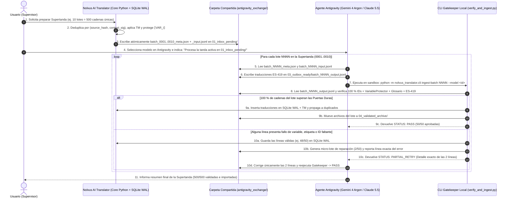

# ARQUITECTURA DE INTEGRACIÓN DE ANTIGRAVITY CON NOLVUS AI TRANSLATOR SIN API
**Documento:** `ANTIGRAVITY_INTEGRATION_ARCHITECTURE.md`  
**Fase:** Fase 10 — Objetivo B: Diseñar la Integración de Antigravity con la Aplicación  
**Estado:** Diseño Arquitectónico Completo (Modo de Solo Diseño — Sin Modificaciones en Código de Producción)

---

## 1. PREMISAS Y HECHOS COMPROBADOS SOBRE GOOGLE ANTIGRAVITY

Siguiendo el criterio de rigor de la **Sección 11**, antes de comparar alternativas se separan los **hechos comprobados** sobre el entorno de Google Antigravity de los **aspectos no verificados o descartados**:

### 1.1. Hechos Comprobados en el Entorno Real del Usuario
1. **Acceso nativo a archivos del Workspace:** El agente de Google Antigravity tiene acceso directo de lectura y escritura sobre el directorio del proyecto (`c:\Skyrim proyecto traducción`) mediante herramientas nativas (`read_file`, `write_file`, `edit_file`) y puede ejecutar scripts locales de Python del entorno virtual (`.venv\Scripts\python.exe`) dentro del sandbox estándar (`BypassSandbox: false`) sin requerir conexión a internet ni permisos elevados fuera del workspace.
2. **Selector de modelos bajo suscripción:** El usuario dispone actualmente en su selector de interfaz de tres modelos de frontera: **`Gemini 4 Argon`**, **`Claude Sonnet 5.5`** y **`Claude Opus 5.5`**.
3. **Inexistencia de API HTTP local pública del selector de suscripción:** Antigravity **no** expone un endpoint REST local tipo `http://localhost:port/v1/chat/completions` que permita a una aplicación externa en Python invocar silenciosamente en segundo plano a `Claude Sonnet 5.5` o `Claude Opus 5.5` usando la cuota de la interfaz gráfica sin pasar por el agente de Antigravity.
4. **Volatilidad de tareas en memoria frente a persistencia en disco:** Se ha comprobado empíricamente que si el servidor de Antigravity se reinicia o la sesión se cierra, los procesos en memoria del agente se detienen (`[Notice] All your subagents and background tasks have been stopped due to server restart`), mientras que **todo archivo escrito en el disco del workspace permanece intacto al `100 %`**.

### 1.2. Por qué se Descarta la Automatización de Interfaz Gráfica (GUI Scripting / Simulación de Clics)
- **Motivo técnico:** Automatizar clics de ratón o pulsaciones de teclado (`PyAutoGUI`, `Win32 SendInput`, `UIAutomation`) sobre la ventana de Antigravity es frágil ante cualquier cambio de foco de ventana, resolución, desplazamiento de scroll o diálogos del sistema; bloquea el uso del equipo por parte del usuario; carece de confirmación transaccional de fin de generación; y puede infringir políticas de uso automatizado abusivo. **Queda descartada por completo.**

---

## 2. EVALUACIÓN COMPARATIVA DE LAS 3 ALTERNATIVAS TÉCNICAS (SECCIÓN 4)

Se evalúan en profundidad las tres alternativas requeridas por la **Sección 4**, más su combinación híbrida:

### 2.1. Alternativa 1: Intercambio de Archivos Estructurados (`File-Based Batch Exchange`)
En este modelo, `Nolvus AI Translator` exporta paquetes de lotes pendientes a disco, el usuario solicita a Antigravity que los traduzca en archivos de respuesta independientes, y la aplicación importa y valida los resultados.

#### Comparación Técnica de Formatos de Intercambio (`JSON` vs `JSONL` vs `CSV`)

| Criterio Técnico | **CSV / TSV** | **JSON Monolítico (`.json`)** | **JSON Lines / NDJSON (`.jsonl`)** |
|---|---|---|---|
| **Integridad ante textos multilínea y HTML de Skyrim** | **Deficiente.** Los libros (`BOOK:DESC`) y diálogos contienen `\r\n`, `\t`, comillas dobles `"` y etiquetas `<font face='...'>`. Un solo escape de comillas mal cerrado desplaza todas las columnas siguientes. | **Alta.** El estándar JSON escapa de forma nativa `\n`, `\r`, `\t` y `\"`. | **Muy Alta (Óptima).** Cada línea es un objeto JSON independiente en UTF-8 terminado en `\n`, con escape nativo de caracteres de control. |
| **Recuperación ante corte o interrupción a mitad de lote** | **Media-Baja.** Una línea multilínea cortada a la mitad deja un campo entrecomillado abierto hasta el final del archivo. | **Baja.** Si un lote de 50 cadenas se interrumpe en la cadena 47, falta el cierre `]}` del documento y `json.loads()` falla para **todo** el archivo, obligando a reparaciones heurísticas. | **Alta, pero no transaccional.** Si el agente se detiene durante la escritura, solo pueden recuperarse las líneas JSON completas que parseen y superen el esquema; la última línea parcial se pone en cuarentena y sus IDs se reintentan. La recuperación efectiva debe medirse, no presuponerse. |
| **Facilidad de escritura incremental (*Append*)** | Alta, pero propensa a errores de columnas. | **Baja.** No se puede hacer `append` a un array JSON cerrado sin reescribir el archivo o manipular el cierre `]`. | **No asumida.** La documentación pública consultada no define un contrato estable `write_file(..., Append=True)`. El protocolo envía un archivo de salida completo a staging; si queda incompleto, el Gatekeeper recupera solo las líneas válidas y reintenta el resto. |
| **Validación línea por línea y localización de errores** | Difícil cuando hay saltos de línea internos. | Un error de sintaxis invalida todo el archivo. | **Inmediata.** El validador indica exactamente: *"Línea 18 (`string_uid=...`): falta `⟦VAR_0⟧`"*, manteniendo válidas las otras 49 líneas. |

- **Conclusión sobre formatos:**
  - **`.json` monolítico** es ideal para el **Manifiesto de Contexto y Metadatos del Lote** (`batch_NNNN_meta.json`), que solo se escribe una vez por `Nolvus AI Translator` y es de solo lectura para el agente.
  - **`.jsonl` (JSON Lines)** es superior en todos los criterios críticos para la **Lista de Cadenas de Entrada** (`batch_NNNN_input.jsonl`) y el **Archivo de Traducciones de Salida** (`batch_NNNN_output.jsonl`).

---

### 2.2. Alternativa 2: Carpeta de Trabajo Compartida (`Shared Exchange Workspace / Hot-Folder Queue`)
En este modelo, existe una estructura de directorios estandarizada dentro del workspace donde cada subcarpeta representa un estado del ciclo de vida del lote:

```text
c:\Skyrim proyecto traducción\workspace_data\antigravity_exchange\
├── 00_protocol\
│   └── ANTIGRAVITY_TRANSLATOR_SKILL.md   (Reglas fijas ES-419, formato JSONL y uso de validador)
├── 01_inbox_pending\                     (Lotes exportados por Nolvus AI Translator listos para traducir)
│   ├── batch_0001_meta.json
│   └── batch_0001_input.jsonl
├── 02_in_progress\                       (Lotes tomados actualmente por el agente; incluye lock/heartbeat)
├── 03_outbox_ready\                      (Traducciones escritas por el agente listas para ingesta)
│   └── batch_0001_output.jsonl
├── 04_validated_archive\                 (Lotes 100 % validados e importados a SQLite + SHA-256)
└── 05_quarantine_retry\                  (Micro-lotes generados automáticamente con ítems rechazados por QA)
```

- **Ventajas:**
  - **Cero fricción con el Sandbox de Antigravity:** Al ubicarse dentro de `c:\Skyrim proyecto traducción\workspace_data\antigravity_exchange\`, el agente tiene permiso automático de lectura y escritura sin pedir confirmación de fuera del workspace.
  - **Separación estricta de permisos:** El agente **solo lee** de `00_protocol/` y `01_inbox_pending/` y **solo escribe** en `03_outbox_ready/`. El agente **jamás** abre ni escribe directamente en `workspace_data/nolvus_translator.db`.
  - **Identificación inequívoca:** Cada archivo lleva en su nombre y en su cabecera el `job_id`, `batch_id`, `batch_index` y `sha256` del lote de entrada.

---

### 2.3. Alternativa 3: Automatización Supervisada mediante Agente (`Agent-Driven Supervised Batch Loop`)
En este modelo, el agente de Antigravity no solo traduce un archivo aislado cuando el usuario se lo pega en el chat, sino que coordina el procesamiento secuencial de una **Supertanda (`Workpack`)** de varios lotes depositados en `01_inbox_pending/` y ejecuta tras cada lote el comando local de validación de `Nolvus AI Translator`.

- **Capacidades reales disponibles en Antigravity que lo permiten (Comprobadas):**
  1. El agente puede listar los lotes pendientes en `01_inbox_pending/`, leer `batch_NNNN_meta.json` y `batch_NNNN_input.jsonl` con `read_file`.
  2. El agente puede escribir `03_outbox_ready/batch_NNNN_output.jsonl` con `write_file`.
  3. El agente puede ejecutar en el sandbox `.venv\Scripts\python.exe -m nolvus_translator.cli verify_batch --batch-id NNNN` mediante `run_command`.
  4. Si `verify_batch` devuelve código `0` (`100 % PASS`), el propio script mueve el lote a `04_validated_archive/` e ingresa las traducciones aprobadas en SQLite de forma transaccional, y el agente pasa al lote `NNNN + 1`.
  5. Si `verify_batch` devuelve código `!= 0` (por ejemplo, en la línea 12 falta `⟦VAR_0⟧` o se omitió un `uid`), el script imprime únicamente las líneas con error; el agente corrige esas líneas específicas en `batch_NNNN_output.jsonl` y vuelve a ejecutar `verify_batch` hasta obtener `PASS`.
- **Limitaciones reales que deben respetarse:**
  - Un turno del agente tiene un límite práctico de pasos de herramientas y de ventana de contexto acumulada. Si el usuario le pidiera procesar `1.000` lotes en un solo turno, el contexto de la conversación se saturaría o alcanzaría el límite de cuota de la suscripción. Por tanto, el procesamiento debe acotarse a **Supertandas supervisadas (`Workpacks` de `5` a `15` lotes por instrucción del usuario, equivalentes a `250`–`750` cadenas por turno)**.

---

### 2.4. Matriz de Comparación de las Alternativas

| Criterio de Evaluación | Alt. 1 Pura (Intercambio manual archivo a archivo) | Alt. 2 Pura (Carpeta compartida sin validador en bucle) | Alt. 3 Pura (Agente libre escribiendo en BD) | **Arquitectura Híbrida Recomendada (Alt. 1 + Alt. 2 + Alt. 3 con Gatekeeper CLI)** |
|---|---|---|---|---|
| **Fiabilidad e Integridad de Datos** | Alta, pero propensa a olvidos manuales de archivos. | Alta en almacenamiento, pero detecta errores tarde. | **Riesgosa** si el agente tocara SQLite directamente. | **Máxima.** El agente solo escribe `.jsonl` en `03_outbox_ready/` y el Gatekeeper determinista en Python valida antes de tocar SQLite. |
| **Trazabilidad** | Media | Alta | Baja | **Total** (hashes SHA-256, logs por lote, `model_id` y `session_id` registrados). |
| **Facilidad de Recuperación ante Cortes** | Alta | Alta | Baja | **Inmediata** (a nivel de línea `.jsonl` individual y por lote en `01_inbox_pending/`). |
| **Intervención Humana Necesaria** | **Muy Alta** (1 acción por cada lote de 25–50 cadenas = `~4.800` a `9.600` acciones). | Media-Alta | Baja, pero sin control de calidad intermedio. | **Mínima y Controlada** (1 instrucción supervisada por cada Supertanda de `10`–`15` lotes, con autorreparación inmediata de `Hard Gates`). |
| **Riesgo de Corrupción de Base de Datos** | `0 %` | `0 %` | Medio-Alto | **`0 %`** (solo `DatabaseManager` en Python escribe en SQLite WAL tras superar todas las validaciones). |

---

## 3. RECOMENDACIÓN TÉCNICA: ARQUITECTURA HÍBRIDA «TRANSACTIONAL JSONL MAILDROP + LOCAL CLI GATEKEEPER»

Se recomienda e institucionaliza la **Arquitectura Híbrida (combinación de las Alternativas 1, 2 y 3)** porque une la seguridad atómica del intercambio de archivos `.jsonl` (Alt. 1), el orden estructural de una cola de carpetas en el workspace (Alt. 2) y la capacidad del agente de Antigravity para procesar varios lotes por turno autovalidando sus salidas con el validador determinista local (Alt. 3).

### 3.1. Diagrama de Flujo de Comunicación entre `Nolvus AI Translator` y `Google Antigravity`



---

## 4. ESPECIFICACIÓN EXACTA DE LOS ARCHIVOS DE INTERCAMBIO

### 4.1. Archivo 1: Manifiesto de Contexto del Lote (`batch_0001_meta.json`)
Generado por `Nolvus AI Translator` en `01_inbox_pending/`:
```json
{
  "schema_version": "1.0",
  "job_id": "job_es419_prod_01",
  "batch_id": 101,
  "batch_index": 1,
  "created_at_utc": "2026-11-03T14:00:00Z",
  "expected_items_count": 50,
  "input_file": "batch_0001_input.jsonl",
  "input_sha256": "e3b0c44298fc1c149afbf4c8996fb92427ae41e4649b934ca495991b7852b855",
  "expected_output_file": "batch_0001_output.jsonl",
  "narrative_context": {
    "universe": "The Elder Scrolls V: Skyrim (Nolvus Awakening 6.0.21)",
    "target_locale": "es-419",
    "context_group_id": "Beyond Skyrim - Bruma:BSHeartland.esm:QUST:CYRBrumaMainQuest",
    "mod_name": "Beyond Skyrim - Bruma",
    "plugin_name": "BSHeartland.esm",
    "content_domain": "dialogues",
    "quest_id": "CYRBrumaMainQuest",
    "speaker_hint": "Captain Adius (Imperial Guard Captain - Formal/Military Tone)"
  },
  "applicable_glossary": [
    {
      "source_term": "County Bruma",
      "approved_translation": "Condado de Bruma",
      "rule": "use_official_translation",
      "keep_original": false
    },
    {
      "source_term": "Pale Pass",
      "approved_translation": "Paso Pálido",
      "rule": "use_official_translation",
      "keep_original": false
    },
    {
      "source_term": "Jauffre",
      "approved_translation": "Jauffre",
      "rule": "preserve_untranslated",
      "keep_original": true
    }
  ],
  "mandatory_constraints": [
    "Usar exclusivamente español latinoamericano neutro (ES-419). Prohibido usar 'vosotros', 'os', 'habéis' o modismos regionales.",
    "Conservar intactos todos los marcadores ⟦VAR_0⟧, ⟦VAR_1⟧, etc. exactamente con el mismo número y sin traducir su interior.",
    "Devolver exactamente 1 línea JSON por cada seq_id en batch_0001_output.jsonl."
  ]
}
```

### 4.2. Archivo 2: Registros de Entrada en JSON Lines (`batch_0001_input.jsonl`)
Cada línea es un objeto JSON compacto con un identificador corto secuencial (`seq`: `1..50`) además del `work_unit_id` y `string_uid` para minimizar tokens y evitar errores de transcripción de IDs largos:
```jsonl
{"seq": 1, "uid": "BSHeartland.esm:0004A110:INFO:NAM1:0", "rec": "INFO:NAM1", "src": "Halt, traveler. The border to County Bruma is closed by order of ⟦VAR_0⟧.", "vars": {"⟦VAR_0⟧": "<Alias=BrumaCount>"}}
{"seq": 2, "uid": "BSHeartland.esm:0004A111:INFO:NAM1:0", "rec": "INFO:NAM1", "src": "Unless you carry an official seal from Pale Pass, you guys will have to turn back immediately.", "vars": {}}
```

### 4.3. Archivo 3: Registros de Salida Escritos por Antigravity (`batch_0001_output.jsonl`)
El agente escribe en `03_outbox_ready/batch_0001_output.jsonl` una línea por cada `seq` con el texto traducido y los marcadores `⟦VAR_i⟧` preservados:
```jsonl
{"seq": 1, "uid": "BSHeartland.esm:0004A110:INFO:NAM1:0", "out": "Alto, viajero. La frontera hacia el Condado de Bruma está cerrada por orden de ⟦VAR_0⟧."}
{"seq": 2, "uid": "BSHeartland.esm:0004A111:INFO:NAM1:0", "out": "A menos que porte un sello oficial del Paso Pálido, ustedes tendrán que regresar de inmediato."}
```

### 4.4. Ventajas Decisivas de este Contrato JSONL
1. **Doble llave de verificación (`seq` + `uid`):** El validador comprueba que `seq` y `uid` coincidan con la línea original, eliminando cualquier riesgo de desalineación (*off-by-one shift*) entre líneas consecutivas.
2. **Transparencia de variables (`vars` de solo lectura):** Al mostrar al modelo en el campo `"vars"` de entrada que `⟦VAR_0⟧` representa `<Alias=BrumaCount>`, el modelo comprende la función gramatical del token (un nombre de persona/título tras la preposición *"de"*) y construye la oración española con concordancia gramatical natural sin poder alterar la etiqueta original `<Alias=BrumaCount>`.
3. **Recuperación instantánea por línea:** Si un archivo se interrumpe en `"seq": 34`, las líneas `1` a `33` ya están completas en disco y listas para importarse.


---

## 5. ADENDA DE VALIDACIÓN TÉCNICA — 2026-11-03

Esta adenda prevalece sobre cualquier afirmación anterior de esta propuesta que sugiera escritura incremental garantizada o recuperación automática al 100 %.

### Decisión recomendada

Se mantiene **Transactional JSONL Maildrop + Local Gatekeeper**, con estas precisiones:

1. **Entrada:** un manifiesto JSON y un JSONL UTF-8 de solo lectura para el agente, con `job_id`, `batch_id`, secuencia, UID, hash y contrato de esquema.
2. **Salida:** un archivo JSONL completo por lote, escrito por el agente en una carpeta de staging. No se usa `Append=True` ni una función de hot-folder no documentada.
3. **Validación:** el Gatekeeper es un proceso local separado. El agente no recibe acceso de escritura a SQLite, DB principal, glosario, TM, archivos originales ni exportación productiva.
4. **Recuperación:** cada línea se parsea y valida individualmente. Solo se recuperan registros completos y válidos; líneas truncadas, duplicadas, inesperadas o con IDs ausentes se ponen en cuarentena. Se verifica el conjunto de IDs esperado y los hashes antes de aceptar el lote.
5. **Persistencia:** durante pruebas, ingesta únicamente en una DB aislada. La escritura en producción queda fuera del alcance de esta fase y requiere autorización posterior.

### Permisos y cuotas de Antigravity

- El sistema operativo de trabajo es Windows. La documentación oficial de Antigravity advierte que la experiencia actualizada de permisos descrita para macOS/Linux no debe asumirse idéntica en Windows; verificar los controles que realmente muestra la instalación del usuario.
- Configurar y comprobar **AI Credit Overages = Never** antes de solicitar trabajo de modelos. Esta opción impide consumo automático de créditos al agotarse la cuota base; no aumenta la cuota incluida.
- Las cuotas son dinámicas, correlacionadas con el esfuerzo de cada tarea y sujetas a cambios. Registrar el uso visible antes y después de cada corrida; no dimensionar capacidad con cifras fijas de un documento antiguo.
- No se ha confirmado mediante este informe el estado actual del ajuste en la cuenta del usuario; debe verificarse manualmente en Settings.

### Estado de validación

La documentación oficial respalda los controles de permisos y el ajuste de excedentes descritos arriba. No documenta que `write_file` soporte `Append=True` como contrato estable. El intercambio por archivo completo con recuperación de líneas válidas es, por tanto, la alternativa más conservadora para probar primero. La arquitectura todavía requiere smoke test de 25 cadenas con una DB de prueba antes del benchmark de 300.

Fuentes oficiales consultadas:
- [Antigravity Permissions](https://antigravity.google/docs/permissions)
- [Antigravity Agent Settings](https://antigravity.google/docs/agent-settings)
- [Antigravity Plans and Overages](https://antigravity.google/docs/plans)
