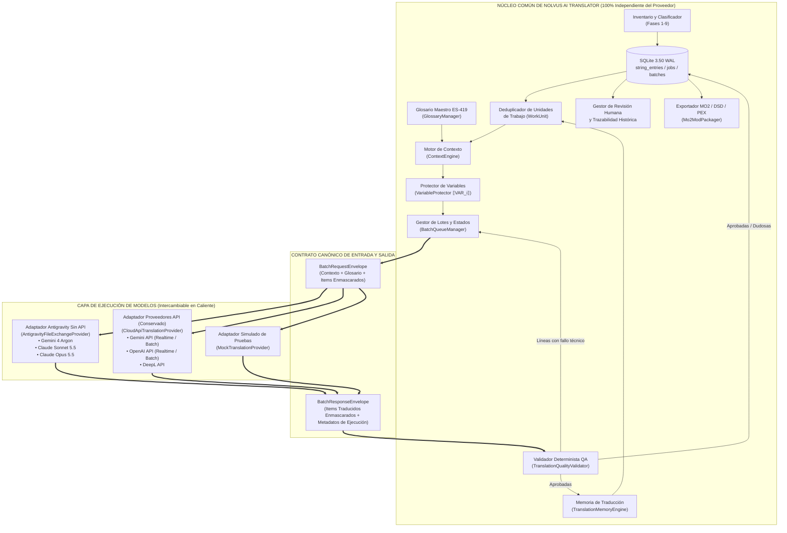

# ARQUITECTURA DUAL INDEPENDIENTE DEL PROVEEDOR (ANTIGRAVITY + API FUTURA)
**Documento:** `DUAL_PROVIDER_ARCHITECTURE.md`  
**Fase:** Fase 10 — Objetivo C: Diseñar una Arquitectura Independiente del Proveedor  
**Estado:** Diseño Arquitectónico Completo (Sin Modificaciones Ejecutadas en Código de Producción)

---

## 1. AUDITORÍA DE LA ARQUITECTURA ACTUAL EN EL CÓDIGO FUENTE (SECCIÓN 2 Y SECCIÓN 5)

Antes de proponer cualquier ampliación, se inspeccionó el código real de `Nolvus AI Translator` en [src/nolvus_translator/](file:///c:/Skyrim%20proyecto%20traducci%C3%B3n/src/nolvus_translator) para determinar qué componentes ya cumplen la separación entre núcleo y proveedor, cuáles deben conservarse intactos y qué punto exacto requiere extensión para soportar tanto a **Google Antigravity sin API** como a **Proveedores API futuros**:

### 1.1. Componentes Existentes que Cumplen el Objetivo y se Reutilizan al `100 %` Sin Reconstruir
1. **Base de Datos y Esquema Central ([core/database.py](file:///c:/Skyrim%20proyecto%20traducci%C3%B3n/src/nolvus_translator/core/database.py)):**
   - La tabla `string_entries` ya almacena `provider_id`, `is_simulated`, `review_status`, `confidence_score` y `quality_json` de forma completamente agnóstica del proveedor.
   - Las tablas `translation_jobs` y `translation_batches` ya modelan trabajos y lotes persistentes en SQLite WAL.
2. **Glosario Maestro ([lore/glossary.py](file:///c:/Skyrim%20proyecto%20traducci%C3%B3n/src/nolvus_translator/lore/glossary.py)) y Motor de Contexto ([lore/context_engine.py](file:///c:/Skyrim%20proyecto%20traducci%C3%B3n/src/nolvus_translator/lore/context_engine.py)):**
   - `NarrativeContextPacket` ya encapsula el universo, el idioma objetivo (`es-419`), el grupo contextual (`context_group_id`), el hablante (`speaker_hint`), las reglas de estilo (`ES419_STYLE_GUIDELINES`) y el glosario filtrado (`applicable_glossary`) sin depender de ningún proveedor.
3. **Memoria de Traducción ([memory/tm_engine.py](file:///c:/Skyrim%20proyecto%20traducci%C3%B3n/src/nolvus_translator/memory/tm_engine.py)):**
   - Indexa por `(source_hash, context_signature)`, distingue coincidencias de mismo contexto vs contexto cruzado, registra historial en `tm_versions` y bloquea traducciones comunitarias (`ALLOWED_ORIGIN_TYPES = {"own_es419", "official_bethesda_reference"}`).
4. **Protección de Variables ([quality/protector.py](file:///c:/Skyrim%20proyecto%20traducci%C3%B3n/src/nolvus_translator/quality/protector.py)) y Validador de QA ([quality/validator.py](file:///c:/Skyrim%20proyecto%20traducci%C3%B3n/src/nolvus_translator/quality/validator.py)):**
   - `VariableProtector` enmascara con `⟦VAR_0⟧`..`⟦VAR_n⟧` antes de tocar cualquier proveedor y restaura/verifica después de recibir la respuesta.
   - `TranslationQualityValidator` califica cualquier traducción entrante con las mismas reglas deterministas, sin importar quién la produjo.
5. **Empaquetador para Mod Organizer 2 ([export/mo2_packager.py](file:///c:/Skyrim%20proyecto%20traducci%C3%B3n/src/nolvus_translator/export/mo2_packager.py)) y DSD ([export/dsd_exporter.py](file:///c:/Skyrim%20proyecto%20traducci%C3%B3n/src/nolvus_translator/export/dsd_exporter.py)):**
   - Exportan exclusivamente a partir de las filas con `review_status = 'approved'` en `string_entries`, siendo `100 %` independientes del motor de traducción utilizado.
6. **Puerto Abstracto de Proveedor ([translation/interfaces.py](file:///c:/Skyrim%20proyecto%20traducci%C3%B3n/src/nolvus_translator/translation/interfaces.py)) y Registro de Stubs API ([translation/future_stubs.py](file:///c:/Skyrim%20proyecto%20traducci%C3%B3n/src/nolvus_translator/translation/future_stubs.py)):**
   - Ya existe la clase abstracta `TranslationProvider` con `TranslationBatchItem` y `TranslationBatchResult`, así como el catálogo `get_registered_providers()` que mantiene registrados los adaptadores futuros de API (`gemini_future`, `openai_future`, `deepl_future`, `local_llm_future`). **Esta infraestructura API existente se conserva íntegra.**

### 1.2. Limitación Específica Detectada en el Acoplamiento Actual de `TranslationPipeline`
Al inspeccionar [translation/pipeline.py](file:///c:/Skyrim%20proyecto%20traducci%C3%B3n/src/nolvus_translator/translation/pipeline.py#L250-L284), se observa que `TranslationPipeline.run_or_resume()` invoca `self.provider.translate_batch(batch_items, context_packet)` dentro de un bucle `while attempt <= self.max_retries` **síncrono y en memoria**.
- Eso funciona de forma inmediata cuando el proveedor responde en milisegundos dentro del mismo proceso Python (`MockTranslationProvider` o una llamada HTTP REST directa).
- Sin embargo, tanto el **Adaptador Antigravity sin API** (basado en intercambio transaccional de archivos `.jsonl` en `antigravity_exchange/`) como las **Modalidades Batch Asíncronas de API** (Gemini Batch API / OpenAI Batch API con archivos `.jsonl`) operan en **dos fases desacopladas en el tiempo**:
  1. **Fase de Despacho (`Prepare & Export Batch`):** El núcleo prepara, protege y exporta el lote o tanda de lotes, dejando el lote en estado `exported_awaiting_provider`.
  2. **Fase de Recepción y Validación (`Collect, Validate & Ingest Batch`):** Cuando el archivo de respuesta está disponible en `03_outbox_ready/` (o en el endpoint Batch API), el núcleo lo recoge, ejecuta las Puertas Duras de QA, persiste los resultados válidos y genera micro-reintentos si alguna línea falló.

---

## 2. ARQUITECTURA HEXAGONAL DE DOBLE CAPA (SECCIÓN 5)

Proponemos formalizar una separación estricta en **dos capas desacopladas** unidas por un **Contrato Canónico de Lote (`BatchEnvelopeContract`)**:



### 2.1. Reglas de Invarianza entre Capas
1. **La Capa de Ejecución carece de acceso a la Base de Datos:** Ningún adaptador de modelo (`AntigravityFileExchangeProvider` ni `CloudApiTranslationProvider`) recibe una referencia a `DatabaseManager`, ni puede modificar `string_entries`, `glossary_terms` o `translation_memory`.
2. **La Capa de Ejecución trabaja exclusivamente sobre texto ya enmascarado (`⟦VAR_i⟧`):** El enmascaramiento ocurre en el Núcleo *antes* de construir el `BatchRequestEnvelope`, y la restauración ocurre en el Núcleo *después* de recibir el `BatchResponseEnvelope`.
3. **Identificadores de Proveedor y Modelo Estandarizados:**
   - Cuando traduce Antigravity: `provider_id = "antigravity_subscription"`, `model_id = "gemini-4-argon" | "claude-sonnet-5.5" | "claude-opus-5.5"`.
   - Cuando traduce una API externa futura: `provider_id = "gemini_api" | "openai_api" | "deepl_api"`, `model_id = "<api_model_id>"`.
   - En ambos casos, el registro resultante en `string_entries` y `translation_memory` tiene exactamente la misma estructura.

---

## 3. CONTRATOS CANÓNICOS DE ENTRADA Y SALIDA

Para que el cambio entre Antigravity y cualquier API externa sea transparente, ambos adaptadores consumen y producen exactamente las mismas estructuras de datos tipadas (extensión limpia y retrocompatible de [translation/interfaces.py](file:///c:/Skyrim%20proyecto%20traducci%C3%B3n/src/nolvus_translator/translation/interfaces.py)):

### 3.1. Contrato de Entrada (`BatchRequestEnvelope`)
```python
@dataclass(frozen=True)
class BatchRequestItem:
    seq_id: int                      # 1..N dentro del lote (verificación posicional rápida)
    work_unit_id: str                # Hash de (source_hash + "|" + context_signature)
    primary_string_uid: str          # string_uid canónico representante
    record_type: str                 # Ej. "INFO", "QUST", "BOOK", "WEAP"
    subrecord_type: str              # Ej. "NAM1", "CNAM", "DESC", "FULL"
    masked_source_text: str          # Texto en inglés con ⟦VAR_0⟧..⟦VAR_k⟧
    protected_vars_preview: dict[str, str]  # Mapa informativo {"⟦VAR_0⟧": "<Alias=Player>"}
    tm_fuzzy_hint: str = ""          # Referencia opcional si existe traducción similar (>=85%) en TM

@dataclass(frozen=True)
class BatchRequestEnvelope:
    schema_version: str              # "1.0"
    job_id: str
    batch_id: int
    batch_index: int
    target_provider_id: str          # "antigravity" | "gemini_api" | "openai_api" | "mock"
    target_model_id: str             # "gemini-4-argon" | "claude-sonnet-5.5" | "claude-opus-5.5" | ...
    context_packet: NarrativeContextPacket
    items: list[BatchRequestItem]
    input_sha256: str
    created_at_utc: str
```

### 3.2. Contrato de Salida (`BatchResponseEnvelope`)
```python
@dataclass(frozen=True)
class BatchResponseItem:
    seq_id: int
    primary_string_uid: str
    translated_masked_text: str
    notes: str = ""

@dataclass(frozen=True)
class BatchResponseEnvelope:
    job_id: str
    batch_id: int
    batch_index: int
    provider_id: str                 # Ej. "antigravity"
    model_id: str                    # Ej. "claude-sonnet-5.5"
    execution_mode: str              # "antigravity_file_exchange" | "api_realtime" | "api_batch" | "simulated"
    is_simulated: bool
    started_at_utc: str
    completed_at_utc: str
    items: list[BatchResponseItem]
    raw_artifact_path: str = ""      # Ruta al archivo .jsonl en 04_validated_archive/ para auditoría
```

---

## 4. FUNCIONAMIENTO DE AMBOS ADAPTADORES SOBRE EL MISMO CONTRATO

### 4.1. Adaptador 1: `AntigravityFileExchangeProvider` (Sin API Externa)
1. **En `export_batch(envelope: BatchRequestEnvelope)`:**
   - Escribe `batch_{batch_index:04d}_meta.json` y `batch_{batch_index:04d}_input.jsonl` en `workspace_data/antigravity_exchange/01_inbox_pending/` usando escritura atómica (`.tmp` → `os.replace`).
   - Actualiza el estado del lote en `translation_batches` a `exported_pending_agent`.
2. **Durante el procesamiento en Antigravity:**
   - El agente de Antigravity (con el modelo elegido por el usuario en el selector: `Gemini 4 Argon`, `Claude Sonnet 5.5` o `Claude Opus 5.5`) lee el lote de `01_inbox_pending/` y escribe `03_outbox_ready/batch_{batch_index:04d}_output.jsonl`.
3. **En `collect_and_parse(batch_id)`:**
   - Lee `03_outbox_ready/batch_{batch_index:04d}_output.jsonl` línea por línea, construye el `BatchResponseEnvelope` y lo entrega al Núcleo para la validación determinista de QA (`TranslationQualityValidator`).

### 4.2. Adaptador 2: `CloudApiTranslationProvider` (Vía Futura Recuperable)
1. Conserva los registros en [translation/future_stubs.py](file:///c:/Skyrim%20proyecto%20traducci%C3%B3n/src/nolvus_translator/translation/future_stubs.py) protegidos por `PHASE_1_PAID_API_LOCK = True` mientras no exista autorización para usar APIs de pago.
2. Si en el futuro el usuario decide activar la vía API (para todo el proyecto o para los lotes restantes):
   - Recibe exactamente el mismo `BatchRequestEnvelope`.
   - En **modo Realtime REST**: serializa `envelope` al formato JSON del SDK de Gemini/OpenAI, recibe la respuesta y devuelve el mismo `BatchResponseEnvelope`.
   - En **modo Batch API (50 % descuento)**: serializa los mismos `BatchRequestEnvelope` en un archivo `.jsonl` de lote en nube y al descargarlo devuelve exactamente los mismos `BatchResponseEnvelope`.

---

## 5. ESTRATEGIA DE SUSTITUCIÓN Y CONMUTACIÓN SIN PÉRDIDA DE PROGRESO

El diseño garantiza que el usuario pueda cambiar en cualquier instante:
- De `Claude Sonnet 5.5` a `Gemini 4 Argon` o `Claude Opus 5.5` dentro de Antigravity.
- De `Antigravity sin API` a `API Externa` (o viceversa).
- O ejecutar un **esquema mixto** (por ejemplo, traducir las misiones principales, diálogos de compañeros y libros con `Claude Opus 5.5` / `Claude Sonnet 5.5` en Antigravity sin coste de API, y procesar lotes masivos de objetos/inventario con otro modelo o vía API).

### ¿Por qué el cambio de proveedor o modelo no altera ningún componente existente?
| Componente del Núcleo | Por Qué Permanece `100 %` Inalterado al Cambiar entre Antigravity y API |
|---|---|
| **Base de datos principal (`nolvus_translator.db`)** | Todas las tablas (`string_entries`, `translation_memory`, `translation_jobs`, `translation_batches`) usan las mismas columnas independientemente del proveedor. |
| **Glosario Maestro (`glossary_terms`)** | El filtrado e inyección de términos ocurre en `ContextEngine` antes de entregar el sobre al adaptador. |
| **Memoria de Traducción (`translation_memory`)** | Las traducciones ya aprobadas con Antigravity se almacenan con `tm_origin_type = 'own_es419'` e `is_simulated = 0`. Si el lote 500 pasa a ejecutarse por API, los lotes 1 a 499 ya están en la TM y jamás se vuelven a traducir. |
| **Identificadores de cadenas (`string_uid` / `source_hash`)** | Son deterministas y dependen únicamente del archivo y registro original de Nolvus Awakening. |
| **Resultados ya aprobados (`review_status = 'approved'`)** | El selector de lotes pendientes filtra estrictamente `review_status IN ('unprocessed', 'rejected')`; ninguna cadena ya aprobada vuelve a entrar en cola al cambiar de proveedor. |
| **Sistema de QA (`TranslationQualityValidator`)** | Valida el `BatchResponseEnvelope` con las mismas puertas duras y pesos sin importar el `provider_id`. |
| **Exportación MO2 (`Mo2ModPackager`)** | Construye los archivos DSD `.json`, `.strings`, `_SPANISH.txt` y `.pex` a partir de `translated_text` en SQLite, sin depender de qué proveedor generó cada fila. |
