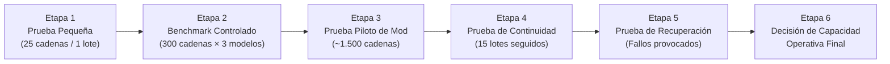

> **ESTADO: ESTIMACIÓN Y PLAN DE PRUEBAS — NO SON MEDICIONES.** Las tasas de cadenas/día, sesiones, tamaños medios de lote, turnos de Workpack y umbrales de 8.000–10.000 o 2.500 cadenas/día son hipótesis/umbrales propuestos, no límites medidos de la cuenta del usuario. Las cuotas de Antigravity varían según el esfuerzo de la tarea y pueden cambiar. Ninguna condición activa API automáticamente: cualquier gasto o cambio de proveedor requiere nueva estimación y autorización expresa.

---

# EVALUACIÓN DE ESCALABILIDAD, CUOTAS, RIESGOS Y PRUEBAS PROGRESIVAS
**Documento:** `SCALABILITY_AND_RISK_ASSESSMENT.md`  
**Fase:** Fase 10 — Sección 8: Evaluación de Escalabilidad y Condiciones de Transición a API  
**Estado:** Análisis Técnico Completo (Separación Estricta entre Hechos Medidos y Proyecciones)

---

## 1. VOLUMEN REAL DE REFERENCIA VERIFICADO EN LA FASE 9 (HECHOS COMPROBADOS)

Toda evaluación de escalabilidad parte exclusivamente de las cifras auditadas y verificadas en la **Fase 9** ([PHASE9_FULL_AUDIT_REPORT.md](file:///c:/Skyrim%20proyecto%20traducci%C3%B3n/PHASE9_FULL_AUDIT_REPORT.md)):

| Métrica de Volumen Verificada (Fase 9) | Cantidad Exacta | Naturaleza del Dato |
|---|---:|---|
| **Ocurrencias traducibles en Corte B (`Snapshot #1` depurado)** | `314.449` | Hecho medido en SQLite |
| **Ocurrencias traducibles en Corte C (`Corte B` + `.pex` de mods en `.bsa`)** | `328.485` | Hecho medido en SQLite + BSA |
| **Cadenas únicas netas pendientes en Corte B (`source_hash`)** | `235.326` | Hecho medido en SQLite |
| **Cadenas únicas netas pendientes en Corte C (`+4.918` de `.pex` en `.bsa`)** | `240.244` | Hecho medido en SQLite + BSA |
| **Cadenas únicas adicionales del Subgrupo 4A de `JSON_OTHER` (*Bestiary*, *Alternate Perspective*, *Custom Skills*)** | `~440` (`~900` ocurrencias) | Hecho medido en Auditoría Fase 9 |
| **VOLUMEN CONSOLIDADO DE PRODUCCIÓN (`Corte C + Subgrupo 4A JSON`)** | **`~240.684` cadenas únicas** | **Base de referencia para Fase 10** |
| **Caracteres únicos en inglés a procesar (`Corte C` sin margen)** | `20.314.890` caracteres | Hecho medido |
| **Ocurrencias redundantes ahorradas por deduplicación `source_hash`** | `88.241` ocurrencias (`40.305` entre plugins) | Hecho medido |

> [!WARNING]
> **Principio Metodológico Obligatorio (Sección 8):**
> Completar con éxito un benchmark de `300` cadenas (`0,125 %` del volumen total) **NO demuestra automáticamente** que sea viable traducir `240.684` cadenas (`802 veces` ese volumen) mediante el selector de Antigravity. Entre `300` y `240.684` cadenas aparecen factores que no son visibles en una prueba pequeña: cuotas por ventana de tiempo de la suscripción, fatiga de supervisión humana, saturación del historial de sesión y tiempo total de reloj (*wall-clock time*). Por ello, **no se inventa ninguna cuota ni velocidad**, y se diseña un protocolo de medición escalonada.

---

## 2. DIMENSIONAMIENTO MATEMÁTICO DEL ESFUERZO OPERATIVO (ESTIMACIONES PARAMÉTRICAS)

Sin inventar tiempos de respuesta del agente (que se medirán empíricamente en el benchmark), podemos calcular de forma **matemáticamente exacta** cuántos archivos de lote y cuántas interacciones de supervisión humana requiere el volumen de `240.684` cadenas bajo dos estrategias de empaquetado:

| Parámetro Estructural | Estrategia Ingenua (Lotes fijos de `25` cadenas, `1` lote por mensaje) | **Estrategia Optimizada Propuesta (Lotes Adaptativos `~58` cadenas media, Supertandas de `12` lotes)** | Reducción de Carga Operativa |
|---|---:|---:|---:|
| **Cadenas únicas a traducir** | `240.684` | `240.684` (menos coincidencias exactas 1:1 de glosario $\approx 238.500$) | `-0,9 %` |
| **Tamaño medio de lote (`batch_size`)** | `25` fijo | Adaptativo: `80` (ítems/UI cortos), `50` (diálogos/misiones), `15` (libros largos) → **Media ponderada: `~58` cadenas/lote** | `+132 %` densidad/lote |
| **Número total de archivos de lote (`.jsonl`)** | **`9.628` lotes** | **`~4.112` lotes** | **`-57,3 %` archivos** |
| **Lotes agrupados por Supertanda (`Workpack`)** | `1` lote por turno del usuario | **`12` lotes por Supertanda** (`~700` cadenas por instrucción del usuario) | `12x` menos turnos |
| **Total de interacciones humanas con el agente para el 100 % del proyecto** | **`9.628` mensajes manuales** *(Inviable operativamente)* | **`~343` turnos de Supertanda** | **`-96,4 %` intervenciones** |

### 2.1. Escenarios Condicionados de Tiempo Total (*Proyecciones Sujetas a Medición Empírica*)
Dado que aún no hemos ejecutado el benchmark, expresamos la duración proyectada como una **función paramétrica** de la velocidad real efectiva $V_{\text{efectiva}}$ (en cadenas validadas por hora de sesión activa, incluyendo eventuales pausas de cuota) que se mida durante las pruebas:

$$\text{Horas de Sesión Activa} = \frac{240.684\text{ cadenas}}{V_{\text{efectiva}}\text{ (cadenas/hora)}}$$

- **Escenario Hipotético A (Alta cadencia sin bloqueo de cuota: p. ej. si $V_{\text{efectiva}} = 3.000\text{ cadenas/hora}$):** Requeriría `~80,2 horas` de ejecución supervisada (`~20 sesiones` de 4 horas).
- **Escenario Hipotético B (Cadencia media o con pausas de enfriamiento de suscripción: p. ej. si $V_{\text{efectiva}} = 1.200\text{ cadenas/hora}$):** Requeriría `~200,5 horas` (`~50 sesiones` de 4 horas).
- **Escenario Hipotético C (Restricción severa de cuota en suscripción: p. ej. si la suscripción limitara a $< 3.000$ cadenas/día):** Requeriría `> 80 días` para el 100 % del volumen, lo que justificaría evaluar, sin activación automática y sujeto a autorización expresa, la **Estrategia Mixta (Antigravity para el 14 % narrativo crítico + API Batch para el 86 % masivo)** descrita en la Sección 5.

---

## 3. ESCALERA DE EVALUACIÓN PROGRESIVA EN 6 ETAPAS (SECCIÓN 8)

Para no comprometer tiempo ni arriesgar la estabilidad del proyecto, la viabilidad de Antigravity se evaluará mediante **6 etapas progresivas con puertas de salida (*Go / No-Go Gates*)**:

### Detalle de las 6 Etapas Progresivas:

| Etapa | Volumen Real | Objetivo Técnico y Operativo | Criterio de Superación (*Gate*) |
|---|---:|---|---|
| **1. Prueba Pequeña de Funcionamiento (*Smoke Test*)** | `25` cadenas (`1` lote) | Verificar de extremo a extremo que `Nolvus AI Translator` exporta `batch_0001_meta.json` + `batch_0001_input.jsonl`, el agente de Antigravity escribe `batch_0001_output.jsonl` y el Gatekeeper CLI valida e importa las 25 cadenas en una base de datos de prueba. | `25/25` cadenas importadas con `0` errores de formato ni de `⟦VAR_i⟧`. |
| **2. Benchmark Controlado de 300 Cadenas** | `300` cadenas × `3` modelos (`900` evaluaciones) | Comparar `Gemini 4 Argon`, `Claude Sonnet 5.5` y `Claude Opus 5.5` en las `11` categorías y en `3` tamaños de lote (`25`, `50`, `100`), midiendo las 12 dimensiones de calidad y las 14 métricas operativas. | Identificar el modelo ganador general, el modelo ganador literario y el tamaño óptimo de lote. |
| **3. Prueba Piloto Representativa (1 Mod Completo)** | `~1.100` a `1.500` cadenas (ej. *Clockwork* o *The Wheels of Lull*) | Probar la estrategia completa **"Anclas Primero" (`Locations/Items` → `Quests/Dialogues` → `Books`)** sobre un mod real completo y generar su paquete MO2 de prueba. | Coherencia terminológica del `100 %` entre objetos, objetivos de misión y diálogos del mod piloto. |
| **4. Prueba de Continuidad y Estrés de Sesión** | `12` a `15` lotes consecutivos en un solo turno (`~750`–`1.000` cadenas) | Observar empíricamente si el agente procesa una Supertanda completa sin degradar la calidad en los últimos lotes y detectar dónde aparecen los primeros avisos de límite/cuota de la suscripción. | Determinar el tamaño máximo seguro de Supertanda ($N_{\text{max\_batches}}$) y la cuota real por ventana horaria. |
| **5. Prueba de Recuperación (*Chaos & Recovery Test*)** | `3` lotes con fallos inyectados deliberadamente | (a) Interrumpir manualmente al agente a mitad de escritura de un `.jsonl`; (b) Inyectar una línea con `⟦VAR_0⟧` faltante y un JSON truncado; (c) Cambiar de modelo a mitad de lote. | Medir cuántas líneas completas y válidas se recuperan; poner en cuarentena la línea truncada y comprobar que el micro-reintento solo incluye los IDs pendientes. |
| **6. Evaluación de Capacidad Operativa y Viabilidad Global** | Proyección basada en datos reales de las Etapas 1–5 | Calcular con datos empíricos medidos ($V_{\text{efectiva}}$, cuota real observada, tasa de reintentos) el tiempo real para las `240.684` cadenas y tomar la decisión de producción. | Elección documentada entre: **Modo A (100 % Antigravity)**, **Modo B (Híbrido Antigravity + API Batch)** o **Modo C (Conmutación a API Batch)**. |

---

## 4. MATRIZ DE RIESGOS Y CONTROLES DE MITIGACIÓN

| ID | Riesgo Identificado | Categoría | Impacto | Probabilidad (Hipótesis) | Control Técnico Diseñado |
|---|---|---|---|---|---|
| **R-01** | **Límites de cuota por ventana de tiempo en la suscripción de Antigravity** (enfriamiento tras N mensajes o N tokens con `Claude Opus 5.5` / `Sonnet 5.5` / `Gemini 4 Argon`). | Operativo / Cuota | Alto | Alta | 1. Deduplicación previa (`-88.241` ocurrencias). 2. Enrutamiento estratificado (usar el modelo de mayor cuota para el `86 %` estándar y reservar `Opus 5.5` para el `14 %` literario). 3. Arquitectura Dual lista para delegar el volumen masivo a API Batch si la cuota diaria resultara insuficiente. |
| **R-02** | **Degradación de atención o deriva terminológica tras procesar muchos lotes en una misma conversación.** | Calidad / Agente | Medio | Media | 1. Las reglas viven en la *Skill* en disco y cada lote lleva su `applicable_glossary` explícito en `batch_NNNN_meta.json`. 2. Renovación periódica de conversación cada `2`–`3` Supertandas sin perder estado gracias a la persistencia en SQLite. |
| **R-03** | **Truncamiento de archivo `.jsonl` o reinicio del servidor de Antigravity a mitad de escritura.** | Integridad Técnica | Alto (si fuera JSON monolítico) → **Bajo con JSONL** | Media | Formato `JSONL` (1 línea = 1 registro válido) + Gatekeeper que rescata todas las líneas completas ya escritas y genera un micro-lote solo para el resto. |
| **R-04** | **Alteración de placeholders `⟦VAR_i⟧`, etiquetas `` o claves `\$` por parte del modelo.** | Integridad Skyrim | Crítico (si llegara al juego) → **Bloqueado** | Media-Baja | Puerta Dura determinista en `VariableProtector.restore_and_verify()` ejecutada por el Gatekeeper CLI antes de aceptar cualquier línea en SQLite. |
| **R-05** | **Rechazo por filtros de seguridad (*Safety Refusal*) en textos oscuros de Skyrim** (asesinatos de *Dark Brotherhood*, horror cósmico de *Vigilant*/*Unslaad*, cultos Daedra). | Operativo / Modelo | Medio | Media | El Gatekeeper aísla únicamente la línea rechazada sin invalidar las otras 49 líneas del lote, permitiendo procesarla con otro modelo del selector o revisarla manualmente en la GUI. |
| **R-06** | **Cambio de disponibilidad de modelos en el selector de Antigravity durante el proyecto.** | Plataforma | Medio | Media | Desacoplamiento total en `DUAL_PROVIDER_ARCHITECTURE.md`: los lotes pendientes en `01_inbox_pending/` no están atados a ningún modelo y pueden procesarse con cualquiera de los otros modelos activos o por API. |

---

## 5. CONDICIONES OBJETIVAS PARA PASAR A API O MODO HÍBRIDO (SECCIÓN 8 Y 10)

Aunque la prioridad actual es aprovechar al máximo Google Antigravity sin coste adicional de API, el proyecto define **5 criterios objetivos de decisión** (que se evaluarán al finalizar la Etapa 4 de las pruebas progresivas) para determinar cuándo mantener el `100 %` en Antigravity y cuándo activar el adaptador API (o un esquema híbrido):

1. **Disparador de Cuota / Velocidad Sostenida (`Throughput Trigger`):**
   - Si tras medir la Etapa 4 se comprueba que las cuotas de la suscripción de Antigravity permiten procesar cómodamente **$\ge 8.000$–$10.000$ cadenas únicas por jornada de uso** sin bloqueos prolongados, **podría ser viable estudiar el modo 100 % Antigravity**; `24`–`30` sesiones es una proyección aritmética condicional, no una predicción operacional.
   - Si, por el contrario, las cuotas de suscripción limitaran el rendimiento efectivo a **$< 2.500$ cadenas/día** (lo que alargaría el proyecto a más de 3 meses de trabajo manual diario), se recomendará activar el **Modo Híbrido**:
     - **En Antigravity (`\$0,00 USD` adicional):** Traducir con **`Claude Opus 5.5` / `Claude Sonnet 5.5` / `Gemini 4 Argon`** el **`12 %–15 %` de mayor valor narrativo y dificultad literaria** (todos los libros `BOOK:DESC`, el Bestiario, las misiones principales y los grandes mods de compañeros como *Inigo*, *Remiel*, *Lucien*, *3DNPC*, *Bruma*, *Vigilant* y *LotD*).
     - **En API Batch (vía `CloudApiTranslationProvider`):** Procesar en segundo plano el **`85 %` restante de cadenas cortas/estructuradas** (armas, armaduras, pociones, menús MCM y diálogos genéricos cortos), cuyo coste total en modalidad Batch (según se calculó en `API_COST_ESTIMATE_V2.md`) es de apenas **`\$3,00` a `\$14,00 USD`**.
2. **Disparador de Carga de Supervisión Humana (`Human Fatigue Trigger`):**
   - Si el número de intervenciones manuales por cada `1.000` cadenas superara las `5` acciones humanas debido a interrupciones constantes de herramienta o límites de longitud de respuesta del agente.
3. **Disparador de Retirada de Modelos en el Selector:**
   - Si en una actualización futura de Antigravity dejaran de estar disponibles los modelos de alta calidad requeridos para el proyecto.
