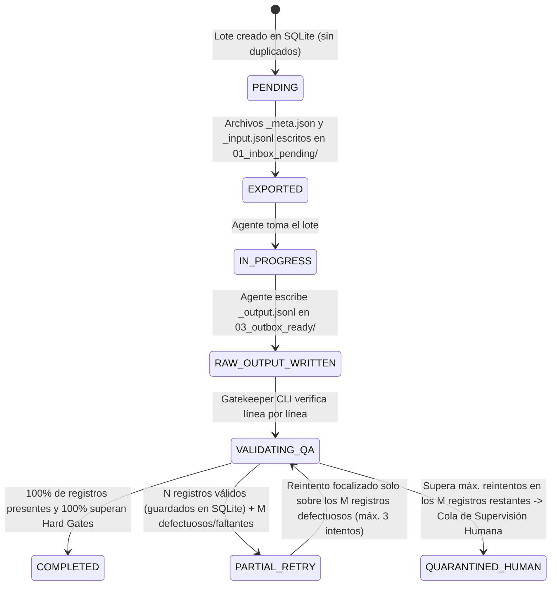

> **ESTADO: DISEÑO PROPUESTO, NO IMPLEMENTACIÓN CERTIFICADA.** Este documento especifica cómo debería comportarse el motor. Las garantías descritas (reanudación, persistencia, QA, propagación TM y exportación) son contratos objetivo; el repositorio publicado contiene documentación y no incluye el código fuente ni la DB para reejecutar sus pruebas. No presentar estos controles como verificados en el runtime actual hasta inspeccionar código y pruebas vigentes.

---

# MOTOR DE EJECUCIÓN DE TRADUCCIÓN: LOTES, PROTECCIÓN, DEDUPLICACIÓN, RECUPERACIÓN Y OPTIMIZACIÓN
**Documento:** `TRANSLATION_EXECUTION_ENGINE.md`  
**Fase:** Fase 10 — Objetivo D (Lógica de Procesamiento) y Objetivo E (Evaluación Crítica de Estrategia Óptima)  
**Estado:** Diseño Técnico Completo (Modo de Solo Diseño)

---

## 1. PREMISA DE INGENIERÍA: GESTIÓN DEL RIESGO RESIDUAL (SECCIÓN 6)

En sistemas distribuidos o asistidos por modelos de lenguaje que procesan `240.684` cadenas únicas (`328.485+` ocurrencias), **ningún componente de IA es infalible**. Los modelos pueden omitir una línea, truncar una salida larga, alucinar una explicación o alterar un marcador; asimismo, la aplicación cliente o el servidor del agente pueden cerrarse a mitad de un lote.

Por tanto, esta arquitectura no asume que el modelo responderá siempre bien, sino que **asume que ocurrirán fallos parciales y diseña controles deterministas en cada etapa** para que ningún fallo corrompa la base de datos ni provoque pérdida del trabajo ya validado.

---

## 2. GESTIÓN DE REGISTROS Y TRAZABILIDAD HISTÓRICA (SECCIÓN 6.1)

### 2.1. Identificación Estable de Cada Cadena y Unidad de Trabajo
Cada ocurrencia en `string_entries` posee dos identificadores inmutables:
1. **`string_uid` (Identificador Estructural de Ocurrencia):** Identifica de forma única la ubicación física/lógica del texto en Nolvus Awakening:
   - En plugins: `<PluginActivo>:<PluginOrigen>:<FormIDHex>:<RecordType>:<SubrecordType>:<SubIndex>` (ej. `3DNPC.esp:3DNPC.esp:0029C112:INFO:NAM1:0`).
   - En archivos MCM/INI/PEX/JSON: `<Formato>:<RutaVirtualNormalizada>:<ClaveOIndice>`.
2. **`work_unit_id` (Identificador de Unidad de Traducción Deduplicada):**
   - Calculado como `SHA-256(source_hash + "|" + context_signature)`.
   - Agrupa todas las ocurrencias que tienen exactamente el mismo texto original en inglés **y** la misma firma de contexto (`content_domain|record_type|subrecord_type|speaker_hint`).

### 2.2. Atributos Auditables por Cadena y Historial Completo de Cambios
En el código actual (`src/nolvus_translator/core/database.py` (ruta de código local; el código fuente no está publicado aquí)), `string_entries` guarda el último estado y `tm_versions` guarda el historial de entradas ya aprobadas en la Memoria de Traducción. Para cumplir íntegramente los 10 requisitos de trazabilidad de la **Sección 6.1** (incluyendo intentos fallidos, cambios de modelo y auditoría por lote), se diseña la tabla complementaria `string_translation_history`:

| Campo Requerido (Sección 6.1) | Ubicación en Esquema SQLite | Descripción Técnica |
|---|---|---|
| **1. Identificador estable** | `string_entries.string_uid` / `work_unit_id` | Clave única determinista e inmutable entre sesiones. |
| **2. Texto original** | `string_entries.source_text` / `source_hash` | Texto original en inglés + hash SHA-256. |
| **3. Origen** | `mod_name`, `virtual_path`, `plugin_name`, `origin_plugin`, `form_id_hex`, `record_type`, `subrecord_type` | Trazabilidad completa hasta el mod de MO2 y el subregistro binario exacto. |
| **4. Contexto** | `content_domain`, `context_group_id`, `quest_id`, `topic_id`, `speaker_hint`, `call_context` | Metadatos narrativos y funcionales asociados al registro. |
| **5. Estado** | `classification` + `review_status` | Estado en el flujo (`unprocessed`, `exported`, `approved`, `dubious`, `rejected`, `requires_lore_research`). |
| **6. Lote** | `batch_id` + `job_id` (en `string_translation_history`) | Vínculo exacto con el lote (`batch_NNNN`) en que fue procesada. |
| **7. Modelo utilizado** | `provider_id` + `model_id` | Ej.: `antigravity:claude-sonnet-5.5`, `antigravity:gemini-4-argon`, `antigravity:claude-opus-5.5`. |
| **8. Fecha de procesamiento** | `processed_at_utc` (`ISO-8601 UTC`) | Marca temporal exacta de recepción y validación. |
| **9. Resultado y Estado de QA** | `translated_text`, `confidence_score`, `quality_json` | Texto traducido restaurado + desglose completo de Puertas Duras y criterios de `TranslationQualityValidator`. |
| **10. Historial de cambios** | Tabla `string_translation_history` + `tm_versions` | Registro append-only de cada versión generada, reintento de QA, cambio de modelo o edición manual del revisor humano. |

---

## 3. GESTIÓN DE LOTES Y MÁQUINA DE ESTADOS ESTRICTA (SECCIÓN 6.2)

### 3.1. Ciclo de Vida de un Lote (Prohibición de Autocompletado Ciego)
Tal como exige la **Sección 6.2**, *"El sistema no debe marcar como completado un lote solamente porque el agente haya terminado su ejecución. Debe comprobar que todos los registros esperados tengan una respuesta válida."*

### 3.2. Los 6 Controles Deterministas antes de Marcar un Lote como `COMPLETED`
El validador local (`BatchIngestionGatekeeper`) ejecuta seis comprobaciones sobre `batch_NNNN_output.jsonl`:
1. **Control de Existencia y No Vacío:** El archivo de salida existe en `03_outbox_ready/` y tiene tamaño `> 0` bytes.
2. **Control de Sintaxis JSONL Línea por Línea:** Cada línea no vacía se parsea individualmente con `json.loads()`. Si una línea está truncada o malformada, se registra el número de línea exacto sin abortar la lectura de las demás líneas válidas.
3. **Control de Biyección Exacta de Identificadores (`Completeness Check`):**
   - Se verifica que para cada `(seq_id, uid)` presente en `batch_NNNN_input.jsonl` exista exactamente una entrada correspondiente en `batch_NNNN_output.jsonl`.
   - Cualquier `uid` omitido por el agente impide que el lote pase a `COMPLETED`.
4. **Control de Puertas Duras Técnicas (`VariableProtector.restore_and_verify()`):**
   - Conteo exacto `1:1` de todos los marcadores `⟦VAR_0⟧`..`⟦VAR_k⟧`.
   - Ausencia de marcadores inventados (`⟦VAR_99⟧`) o caracteres residuales `⟦` / `⟧`.
   - Balance exacto de etiquetas HTML/Scaleform (``, `
`, `<b>`, `<i>`, `<u>`, `[pagebreak]`).
   - Compatibilidad de codificación de destino (`UTF-16LE` para `mcm_txt`, `UTF-8` para `DSD`/`STRINGS`/`PEX`).
5. **Control de No-Traducción Accidental (`Untranslated Echo Check`):**
   - Si la cadena original tiene $\ge 3$ palabras traducibles (y no es un nombre propio protegido) pero el modelo devolvió exactamente el mismo texto en inglés (`translated_text.strip() == source_text.strip()`), se rechaza como omisión encubierta.
6. **Persistencia Parcial Inmediata y Micro-Reintento Aislado (`Fault Isolation`):**
   - Si en un lote de `50` cadenas, `48` superan todos los controles y `2` fallan (por ejemplo, una línea omitida y una con un placeholder `⟦VAR_0⟧` faltante):
     - Las **`48` cadenas válidas se guardan y aprueban inmediatamente en SQLite WAL y en la Memoria de Traducción**, quedando aseguradas en disco.
     - El lote pasa a estado `PARTIAL_RETRY` y el Gatekeeper genera automáticamente un micro-lote (`batch_NNNN_retry1_input.jsonl`) que contiene **únicamente las `2` cadenas pendientes** junto con el mensaje de error específico (ej. *"Error previo en seq=19: omitiste el marcador obligatorio ⟦VAR_0⟧"*).
     - Se permite un máximo configurable de `max_retries = 3` micro-reintentos por lote. Si tras 3 intentos una cadena individual sigue fallando, esa cadena aislada pasa a `QUARANTINED_HUMAN` (`review_status = 'rejected'`) para revisión manual en la GUI, sin bloquear jamás a los demás lotes.

---

## 4. PROTECCIÓN DE CONTENIDO Y SALVAGUARDAS DE FASE 9 (SECCIÓN 6.3)

Se conserva íntegro el motor `src/nolvus_translator/quality/protector.py` (ruta de código local; el código fuente no está publicado aquí) y se incorporan las reglas de protección verificadas en la auditoría de la Fase 9:

| Elemento a Proteger | Mecanismo de Protección Determinista | Verificación Post-Traducción |
|---|---|---|
| **Referencias `FormID\|Plugin.esp` (DSD/INI)** | Regex `dsd_form_ref` → enmascarado como `⟦VAR_i⟧`. | Restauración exacta 1:1. |
| **Etiquetas de motor Skyrim (`<Alias=...>`, `<Global=...>`, `<mag>`, `<dur>`, `<area>`, `<1>`)** | Regex `skyrim_alias_global` y `skyrim_magic_token` → `⟦VAR_i⟧`. | Restauración exacta 1:1; prohibido traducir el nombre del alias interno (`<Alias=Player>` jamás pasa a `<Alias=Jugador>`). |
| **Etiquetas HTML/Scaleform (``, `
`, ``, `[pagebreak]`)** | Cada etiqueta de apertura o cierre se enmascara individualmente como `⟦VAR_i⟧`, dejando expuesto solo el texto visible entre etiquetas. | Restauración 1:1 + verificación de balance de etiquetas abiertas/cerradas. |
| **Especificadores `printf` (`%s`, `%d`, `%.1f`, `%.0f%%`) y llaves (`{0}`, `{1}`)** | Regex `printf_specifier` y `brace_placeholder` → `⟦VAR_i⟧`. | Restauración exacta 1:1. |
| **Claves `\$` en archivos `Interface/Translations/*.txt` y `MCM/Config/*/config.json`** | En `mcm_parser.py`, la columna izquierda (`$KeyName`) se separa estructuralmente por el tabulador `\t` y **nunca se envía como texto traducible** (queda en `editor_id`). Si dentro del valor derecho aparece una referencia `$OtraClave`, `mcm_dollar_token` la enmascara como `⟦VAR_i⟧`. | Al exportar en `build_mcm_translation_txt_bytes`, se reconstruye `editor_id + "\t" + translated_text` en `UTF-16LE BOM`, con objetivo de `0` claves `\# MOTOR DE EJECUCIÓN DE TRADUCCIÓN: LOTES, PROTECCIÓN, DEDUPLICACIÓN, RECUPERACIÓN Y OPTIMIZACIÓN
**Documento:** `TRANSLATION_EXECUTION_ENGINE.md`  
**Fase:** Fase 10 — Objetivo D (Lógica de Procesamiento) y Objetivo E (Evaluación Crítica de Estrategia Óptima)  
**Estado:** Diseño Técnico Completo (Modo de Solo Diseño)

---

## 1. PREMISA DE INGENIERÍA: GESTIÓN DEL RIESGO RESIDUAL (SECCIÓN 6)

En sistemas distribuidos o asistidos por modelos de lenguaje que procesan `240.684` cadenas únicas (`328.485+` ocurrencias), **ningún componente de IA es infalible**. Los modelos pueden omitir una línea, truncar una salida larga, alucinar una explicación o alterar un marcador; asimismo, la aplicación cliente o el servidor del agente pueden cerrarse a mitad de un lote.

Por tanto, esta arquitectura no asume que el modelo responderá siempre bien, sino que **asume que ocurrirán fallos parciales y diseña controles deterministas en cada etapa** para que ningún fallo corrompa la base de datos ni provoque pérdida del trabajo ya validado.

---

## 2. GESTIÓN DE REGISTROS Y TRAZABILIDAD HISTÓRICA (SECCIÓN 6.1)

### 2.1. Identificación Estable de Cada Cadena y Unidad de Trabajo
Cada ocurrencia en `string_entries` posee dos identificadores inmutables:
1. **`string_uid` (Identificador Estructural de Ocurrencia):** Identifica de forma única la ubicación física/lógica del texto en Nolvus Awakening:
   - En plugins: `<PluginActivo>:<PluginOrigen>:<FormIDHex>:<RecordType>:<SubrecordType>:<SubIndex>` (ej. `3DNPC.esp:3DNPC.esp:0029C112:INFO:NAM1:0`).
   - En archivos MCM/INI/PEX/JSON: `<Formato>:<RutaVirtualNormalizada>:<ClaveOIndice>`.
2. **`work_unit_id` (Identificador de Unidad de Traducción Deduplicada):**
   - Calculado como `SHA-256(source_hash + "|" + context_signature)`.
   - Agrupa todas las ocurrencias que tienen exactamente el mismo texto original en inglés **y** la misma firma de contexto (`content_domain|record_type|subrecord_type|speaker_hint`).

### 2.2. Atributos Auditables por Cadena y Historial Completo de Cambios
En el código actual (`src/nolvus_translator/core/database.py` (ruta de código local; el código fuente no está publicado aquí)), `string_entries` guarda el último estado y `tm_versions` guarda el historial de entradas ya aprobadas en la Memoria de Traducción. Para cumplir íntegramente los 10 requisitos de trazabilidad de la **Sección 6.1** (incluyendo intentos fallidos, cambios de modelo y auditoría por lote), se diseña la tabla complementaria `string_translation_history`:

| Campo Requerido (Sección 6.1) | Ubicación en Esquema SQLite | Descripción Técnica |
|---|---|---|
| **1. Identificador estable** | `string_entries.string_uid` / `work_unit_id` | Clave única determinista e inmutable entre sesiones. |
| **2. Texto original** | `string_entries.source_text` / `source_hash` | Texto original en inglés + hash SHA-256. |
| **3. Origen** | `mod_name`, `virtual_path`, `plugin_name`, `origin_plugin`, `form_id_hex`, `record_type`, `subrecord_type` | Trazabilidad completa hasta el mod de MO2 y el subregistro binario exacto. |
| **4. Contexto** | `content_domain`, `context_group_id`, `quest_id`, `topic_id`, `speaker_hint`, `call_context` | Metadatos narrativos y funcionales asociados al registro. |
| **5. Estado** | `classification` + `review_status` | Estado en el flujo (`unprocessed`, `exported`, `approved`, `dubious`, `rejected`, `requires_lore_research`). |
| **6. Lote** | `batch_id` + `job_id` (en `string_translation_history`) | Vínculo exacto con el lote (`batch_NNNN`) en que fue procesada. |
| **7. Modelo utilizado** | `provider_id` + `model_id` | Ej.: `antigravity:claude-sonnet-5.5`, `antigravity:gemini-4-argon`, `antigravity:claude-opus-5.5`. |
| **8. Fecha de procesamiento** | `processed_at_utc` (`ISO-8601 UTC`) | Marca temporal exacta de recepción y validación. |
| **9. Resultado y Estado de QA** | `translated_text`, `confidence_score`, `quality_json` | Texto traducido restaurado + desglose completo de Puertas Duras y criterios de `TranslationQualityValidator`. |
| **10. Historial de cambios** | Tabla `string_translation_history` + `tm_versions` | Registro append-only de cada versión generada, reintento de QA, cambio de modelo o edición manual del revisor humano. |

---

## 3. GESTIÓN DE LOTES Y MÁQUINA DE ESTADOS ESTRICTA (SECCIÓN 6.2)

### 3.1. Ciclo de Vida de un Lote (Prohibición de Autocompletado Ciego)
Tal como exige la **Sección 6.2**, *"El sistema no debe marcar como completado un lote solamente porque el agente haya terminado su ejecución. Debe comprobar que todos los registros esperados tengan una respuesta válida."*

### 3.2. Los 6 Controles Deterministas antes de Marcar un Lote como `COMPLETED`
El validador local (`BatchIngestionGatekeeper`) ejecuta seis comprobaciones sobre `batch_NNNN_output.jsonl`:
1. **Control de Existencia y No Vacío:** El archivo de salida existe en `03_outbox_ready/` y tiene tamaño `> 0` bytes.
2. **Control de Sintaxis JSONL Línea por Línea:** Cada línea no vacía se parsea individualmente con `json.loads()`. Si una línea está truncada o malformada, se registra el número de línea exacto sin abortar la lectura de las demás líneas válidas.
3. **Control de Biyección Exacta de Identificadores (`Completeness Check`):**
   - Se verifica que para cada `(seq_id, uid)` presente en `batch_NNNN_input.jsonl` exista exactamente una entrada correspondiente en `batch_NNNN_output.jsonl`.
   - Cualquier `uid` omitido por el agente impide que el lote pase a `COMPLETED`.
4. **Control de Puertas Duras Técnicas (`VariableProtector.restore_and_verify()`):**
   - Conteo exacto `1:1` de todos los marcadores `⟦VAR_0⟧`..`⟦VAR_k⟧`.
   - Ausencia de marcadores inventados (`⟦VAR_99⟧`) o caracteres residuales `⟦` / `⟧`.
   - Balance exacto de etiquetas HTML/Scaleform (``, `
`, `<b>`, `<i>`, `<u>`, `[pagebreak]`).
   - Compatibilidad de codificación de destino (`UTF-16LE` para `mcm_txt`, `UTF-8` para `DSD`/`STRINGS`/`PEX`).
5. **Control de No-Traducción Accidental (`Untranslated Echo Check`):**
   - Si la cadena original tiene $\ge 3$ palabras traducibles (y no es un nombre propio protegido) pero el modelo devolvió exactamente el mismo texto en inglés (`translated_text.strip() == source_text.strip()`), se rechaza como omisión encubierta.
6. **Persistencia Parcial Inmediata y Micro-Reintento Aislado (`Fault Isolation`):**
   - Si en un lote de `50` cadenas, `48` superan todos los controles y `2` fallan (por ejemplo, una línea omitida y una con un placeholder `⟦VAR_0⟧` faltante):
     - Las **`48` cadenas válidas se guardan y aprueban inmediatamente en SQLite WAL y en la Memoria de Traducción**, quedando aseguradas en disco.
     - El lote pasa a estado `PARTIAL_RETRY` y el Gatekeeper genera automáticamente un micro-lote (`batch_NNNN_retry1_input.jsonl`) que contiene **únicamente las `2` cadenas pendientes** junto con el mensaje de error específico (ej. *"Error previo en seq=19: omitiste el marcador obligatorio ⟦VAR_0⟧"*).
     - Se permite un máximo configurable de `max_retries = 3` micro-reintentos por lote. Si tras 3 intentos una cadena individual sigue fallando, esa cadena aislada pasa a `QUARANTINED_HUMAN` (`review_status = 'rejected'`) para revisión manual en la GUI, sin bloquear jamás a los demás lotes.

---

## 4. PROTECCIÓN DE CONTENIDO Y SALVAGUARDAS DE FASE 9 (SECCIÓN 6.3)

Se conserva íntegro el motor `src/nolvus_translator/quality/protector.py` (ruta de código local; el código fuente no está publicado aquí) y se incorporan las reglas de protección verificadas en la auditoría de la Fase 9:

| Elemento a Proteger | Mecanismo de Protección Determinista | Verificación Post-Traducción |
|---|---|---|
| **Referencias `FormID\|Plugin.esp` (DSD/INI)** | Regex `dsd_form_ref` → enmascarado como `⟦VAR_i⟧`. | Restauración exacta 1:1. |
| **Etiquetas de motor Skyrim (`<Alias=...>`, `<Global=...>`, `<mag>`, `<dur>`, `<area>`, `<1>`)** | Regex `skyrim_alias_global` y `skyrim_magic_token` → `⟦VAR_i⟧`. | Restauración exacta 1:1; prohibido traducir el nombre del alias interno (`<Alias=Player>` jamás pasa a `<Alias=Jugador>`). |
| **Etiquetas HTML/Scaleform (``, `
`, ``, `[pagebreak]`)** | Cada etiqueta de apertura o cierre se enmascara individualmente como `⟦VAR_i⟧`, dejando expuesto solo el texto visible entre etiquetas. | Restauración 1:1 + verificación de balance de etiquetas abiertas/cerradas. |
| **Especificadores `printf` (`%s`, `%d`, `%.1f`, `%.0f%%`) y llaves (`{0}`, `{1}`)** | Regex `printf_specifier` y `brace_placeholder` → `⟦VAR_i⟧`. | Restauración exacta 1:1. |
| **Claves `\$` en archivos `Interface/Translations/*.txt` y `MCM/Config/*/config.json`** | En `mcm_parser.py`, la columna izquierda (`$KeyName`) se separa estructuralmente por el tabulador `\t` y **nunca se envía como texto traducible** (queda en `editor_id`). Si dentro del valor derecho aparece una referencia `$OtraClave`, `mcm_dollar_token` la enmascara como `⟦VAR_i⟧`. | Al exportar en `build_mcm_translation_txt_bytes`, se reconstruye `editor_id + "\t" + translated_text` en `UTF-16LE BOM`,  alteradas; el resultado debe comprobarse con pruebas de ida y vuelta. |
| **Nombres propios puros (`NPC_:FULL`, `NPC_:SHRT` con `classification = protected_proper_noun`)** | `8.667` ocurrencias (`4.931` únicas) se resuelven directamente en el Paso 1 local (`translated_text = source_text`, `provider_id = 'glossary_protection'`) **sin enviarlas a ningún modelo de IA**. | `0` riesgo de hispanización accidental de nombres propios puros. |
| **Normalización previa de los `38` apóstrofes corruptos de `3DNPC.esp` (Hallazgo Fase 9)** | Filtro determinista pre-enmascarado que convierte la secuencia corrupta Windows-1252 `\ufffd'` (ej. `I\ufffd've`, `don\ufffd't`) en apóstrofe estándar ASCII `'` (`I've`, `don't`). | Elimina el artefacto `\ufffd` antes de que llegue al modelo o al archivo final. |

---

## 5. GESTIÓN INTELIGENTE DE DUPLICADOS Y CONTEXTO (SECCIÓN 6.4)

La Fase 9 demostró que en Nolvus Awakening existen **`328.485` ocurrencias traducibles** (Corte C), pero solo **`240.244` cadenas únicas por `source_hash`** (`88.241` ocurrencias repetidas, incluyendo `40.305` repeticiones provocadas por parches de resolución de conflictos entre plugins).

Sin embargo, tal como advierte la **Sección 6.4**, **no toda cadena con el mismo `source_text` significa lo mismo si cambia su contexto**. Por ello, el sistema diferencia tres casos formales:

### 5.1. Caso 1: Cadenas Idénticas con Contexto Compatible (`Same Source + Compatible Context`)
- **Condición:** Dos ocurrencias tienen el mismo `source_hash` **y** pertenecen al mismo tipo de registro/dominio (`context_signature = content_domain|record_type|subrecord_type|speaker_hint`), como sucede cuando un parche (`Nolvus Awakening Armors Balance Patch.esp`) copia el registro `ARMO:FULL` o `WEAP:FULL` del plugin base, o cuando dos guardias comparten la misma línea de diálogo genérica.
- **Acción:** Se agrupan **antes de crear los lotes** en una única `TranslationWorkUnit`. Se traduce **una sola vez** y, al superar el QA, la traducción se propaga atómicamente a todas las filas de `string_entries` que comparten ese `(source_hash, context_signature)`.

### 5.2. Caso 2: Cadenas Idénticas con Contexto Diferente (`Same Source + Divergent Context — Polisemia`)
- **Condición:** Dos ocurrencias tienen exactamente el mismo `source_text`, pero diferente `record_type` o `content_domain`.
- **Regla de Desambiguación por Longitud y Ambigüedad:**
  1. **Textos cortos o potencialmente polisémicos ($\le 5$ palabras o $\le 35$ caracteres, ej. `"Fire"`, `"Light"`, `"Charge"`, `"Ward"`, `"Steel"`, `"Scroll"`, `"Chest"`):**
     - **Jamás se reutilizan automáticamente entre contextos distintos.**
     - Generan `TranslationWorkUnit` independientes para cada `context_signature` (una unidad para `"Fire"` en `SPEL:FULL` y otra unidad distinta para `"Fire"` en `INFO:NAM1` o `MCM_TXT`), enviando a cada lote su contexto específico para que el modelo traduzca *"Fuego"* en el hechizo y *"¡Disparen!"* en el diálogo.
  2. **Oraciones completas no ambiguas ($> 5$ palabras y $> 35$ caracteres):**
     - Si existe una traducción aprobada en la Memoria de Traducción pero con distinto `speaker_hint` o `record_type`, el motor aplica la regla ya implementada en `src/nolvus_translator/translation/pipeline.py` (ruta de código local; el código fuente no está publicado aquí): reutiliza la traducción con estado `ReviewStatus.DUBIOUS` (`confidence_score = 0.78`) e inserta una alerta explícita para verificación rápida, evitando tanto el trabajo redundante como la propagación silenciosa de un posible matiz de hablante.

### 5.3. Caso 3: Cadenas Similares (`Fuzzy Matches` en Memoria de Traducción)
- **Condición:** Una cadena nueva tiene una similitud de entre el **`85 %` y el `99 %`** (calculada localmente con `FTS5` + `RapidFuzz` en `src/nolvus_translator/memory/tm_engine.py` (ruta de código local; el código fuente no está publicado aquí)) respecto a una cadena ya aprobada en la TM (ej. `"Potion of Minor Stamina"` cuando ya está aprobada `"Potion of Extreme Stamina"` → `"Poción de aguante extremo"`).
- **Acción:** Nunca se sustituye automáticamente; en su lugar, se adjunta en el campo `tm_fuzzy_hint` del ítem dentro del lote para que el modelo mantenga exactamente la misma plantilla sintáctica y terminológica.

---

## 6. RECUPERACIÓN Y CONSISTENCIA ANTE FALLOS (SECCIÓN 6.5)

La arquitectura está diseñada bajo el principio de **Idempotencia y Persistencia Atómica por Punto de Control (`Checkpoint-per-Batch & Line-Level JSONL Recovery`)**:

| Escenario de Fallo (Sección 6.5) | Qué Ocurre en el Sistema | Cómo se Recupera sin Perder Trabajo Validado |
|---|---|---|
| **1. Cierre inesperado de Antigravity o del PC** | Los lotes ya validados están confirmados en `nolvus_translator.db` (SQLite WAL `synchronous=NORMAL`) y archivados en `04_validated_archive/`. El lote activo queda en `01_inbox_pending/` o parcialmente escrito en `03_outbox_ready/`. | Al reabrir, el comando `recover-session` inspecciona `03_outbox_ready/`: importa todas las líneas `.jsonl` completas que ya se hubieran escrito antes del cierre y genera un sub-lote únicamente con las líneas faltantes. |
| **2. Interrupción del agente o reinicio del servidor de Antigravity** | El turno del agente se detiene a mitad de una tanda de 10 lotes (p. ej. tras completar el lote 6 y escribir 20 líneas del lote 7). | Los lotes 1 a 6 ya fueron validados e ingresados en SQLite por el Gatekeeper tras cada lote. Del lote 7 se rescatan las 20 líneas ya escritas en disco y la nueva sesión continúa desde la línea 21 del lote 7. |
| **3. Resultado malformado o lote incompleto** | El agente escribe una línea JSON truncada o se salta 3 `seq_id` de un lote de 50. | El Gatekeeper parsea línea por línea: aprueba y guarda en SQLite las 47 líneas válidas, y crea automáticamente el archivo de reintento con las 3 líneas faltantes/rotas. |
| **4. Cambio de modelo a mitad del proyecto** | El usuario decide cambiar de `Claude Sonnet 5.5` a `Gemini 4 Argon` (o viceversa) a partir del lote 150. | Como cada lote es autocontenido (`batch_NNNN_meta.json` incluye el glosario aplicable y las referencias de la Memoria de Traducción ya aprobada), el nuevo modelo recibe automáticamente los términos y referencias fijados en los lotes 1 a 149, manteniendo la coherencia terminológica. |
| **5. Cambio de sesión / nueva conversación en Antigravity** | El usuario abre un chat limpio en Antigravity para liberar ventana de contexto. | El estado **no** vive en el historial del chat, sino en SQLite y en las carpetas `01_inbox_pending/` y `04_validated_archive/`. La nueva conversación retoma instantáneamente el siguiente lote pendiente. |

---

## 7. SUPERVISIÓN HUMANA Y DISPARADORES DE INTERVENCIÓN (SECCIÓN 6.6)

El sistema no detiene al usuario por errores técnicos autorreparables (como reintentar una línea donde faltó un marcador `⟦VAR_0⟧` en el intento 1), pero **sí exige supervisión o decisión humana** en las siguientes 7 situaciones bien definidas:

1. **Términos nuevos de Lore o Nombres Propios Ambiguos (`REQUIRES_LORE_RESEARCH`):** Cadenas clasificadas en `pending_research` (`718` ocurrencias) o donde el detector de entidades desconocidas identifica un posible nombre propio/título nuevo de un mod que debe fijarse en el Glosario Maestro antes de propagarse a cientos de diálogos.
2. **Fallos Críticos Persistentes tras agotar los Reintentos (`attempts > max_retries`):** Si una cadena específica falla las Puertas Duras de QA después de `3` micro-reintentos (por ejemplo, por una etiqueta HTML rota de origen o un bloqueo de filtro de seguridad del modelo ante un texto oscuro de *Vigilant* o *Dark Brotherhood*), la cadena se aísla en la pestaña **Gestor de Revisiones** de la GUI para edición humana directa.
3. **Coincidencias de Memoria de Traducción con Contexto Cruzado (`ReviewStatus.DUBIOUS`):** Cuando una frase se reutiliza entre registros de naturaleza distinta y queda marcada con confianza `0.78` para confirmación visual.
4. **Conflictos en el Glosario Maestro (`GlossaryConflictError`):** Cualquier intento de modificar la traducción de un término que ya estaba en estado `approved`.
5. **Textos Narrativos Clave de Alta Visibilidad (Muestreo de Auditoría en Libros y Compañeros Principales):** Revisión por muestreo de los primeros lotes de grandes mods narrativos (*Interesting NPCs*, *Inigo*, *Remiel*, *Lucien*, *Beyond Skyrim - Bruma*, *Legacy of the Dragonborn*).
6. **Cambio de Modelo o de Proveedor:** La selección de otro modelo en el selector de Antigravity o la conmutación futura hacia API requiere siempre acción explícita del usuario.
7. **Avisos de Cuota o Enfriamiento en Antigravity:** Si la interfaz de Antigravity muestra un aviso de límite de uso de la suscripción para el modelo activo, el flujo se pausa de forma limpia al terminar el lote en curso y solicita al usuario decidir si esperar la renovación de la ventana de cuota o cambiar a otro modelo disponible en su selector.

---

## 8. OBJETIVO E: EVALUACIÓN CRÍTICA — ¿EXISTE UNA ESTRATEGIA MEJOR? (SECCIÓN 7)

Aplicando el análisis crítico exigido en la **Sección 7**, evaluamos la propuesta base y demostramos que **un enfoque ingenuo de procesar `240.684` cadenas enviando lotes aislados de 25 cadenas de forma desordenada tendría cuellos de botella operativos graves** (`~9.628` lotes individuales).

A continuación respondemos a cada una de las 10 preguntas críticas de la **Sección 7** y presentamos las **5 Mejoras Arquitectónicas Superiores** que deben adoptarse:

### 8.1. Respuestas Críticas y Alternativas Superiores

| Pregunta Crítica (Sección 7) | Análisis Técnico y Solución Superior Propuesta |
|---|---|
| **1. ¿Existe una forma más eficaz de utilizar Antigravity sin API?** | **Sí: Bucle de Supertandas (`Workpacks`) con Validación Local Integrada.** En lugar de que el usuario copie/pegue textos en el chat o pida 1 lote por mensaje, la aplicación deposita en `01_inbox_pending/` una **Supertanda (`Workpack`) de `10` a `15` lotes pre-agrupados**, y el usuario envía **una sola instrucción corta** al agente para que procese y autovalide con el Gatekeeper CLI toda la supertanda en secuencia. |
| **2. ¿Podemos reducir el número de interacciones necesarias con el agente?** | **Sí, en más de un `92 %`.** Combinando: (a) Deduplicación previa en `WorkUnits` (`328.485` ocurrencias → `240.684` unidades), (b) Tamaño de lote adaptativo según longitud (`80`–`100` cadenas para ítems cortos de inventario/MCM, `50` para diálogos estándar y `15`–`20` para libros largos), lo que reduce el total de lotes de `9.628` a **`~4.100` lotes**, y (c) Supertandas de `10`–`15` lotes por turno, reduciendo las interacciones humanas de `9.628` a **`~275–410` turnos supervisados** en todo el proyecto. |
| **3. ¿Podemos gestionar los lotes con mayor fiabilidad?** | **Sí: Tamaño de Lote Adaptativo por Presupuesto de Caracteres/Tokens (`Adaptive Token-Budget Batching`) en vez de un número fijo de 25 cadenas.** Un lote de 25 libros de `6.000` caracteres (`150.000` chars) desbordaría la salida del modelo y causaría truncamiento, mientras que un lote de 25 nombres de espadas de `18` caracteres (`450` chars) desaprovecha el turno. La solución superior es fijar un **doble límite por lote**: `máximo N cadenas (hasta 80 en textos cortos)` **Y** `máximo 12.000 caracteres (~3.200 tokens de salida)` por archivo `.jsonl`. |
| **4. ¿Es conveniente separar los lotes por mod, categoría o complejidad?** | **Sí, es crítico.** Mezclar en un mismo lote una línea de diálogo de un bandido, el nombre de una poción, una opción técnica de MCM y un párrafo de un libro religioso obliga al modelo a cambiar constantemente de registro lingüístico y degrada la calidad. La estrategia óptima es una **Jerarquía de Agrupación en 3 Niveles**: `1º Dominio Funcional` → `2º Mod / Misión / Hablante (context_group_id)` → `3º Complejidad (Estándar vs Literaria)`. |
| **5. ¿Conviene utilizar un modelo general y escalar únicamente los casos difíciles?** | **Sí (`Tiered Model Routing`).** En Nolvus Awakening, el **`~86 %` del volumen** son textos cortos o estructurados (armas, armaduras, efectos mágicos, objetivos breves, menús MCM y diálogos directos) que el modelo más ágil y de mayor cuota en Antigravity (p. ej. `Gemini 4 Argon` o `Claude Sonnet 5.5`, según confirme el benchmark) puede procesar a alta velocidad. El **`~14 %` restante** (`BOOK:DESC`, entradas del Bestiario, diálogos filosóficos de *3DNPC*/*Vigilant*/*Inigo* y las cadenas de `pending_research`) se reserva para el modelo de máxima capacidad literaria (`Claude Opus 5.5` o el ganador literario del benchmark). Esto preserva la cuota del modelo más pesado donde realmente aporta valor diferencial. |
| **6. ¿Podemos aprovechar mejor la Memoria de Traducción?** | **Sí: Propagación Pre-Lote + Diccionario de Plantillas Modulares (`Template Pattern Acceleration`).** En Skyrim/Nolvus existen más de `25.000` nombres de objetos del tipo `<Material> <Objeto> of <Encantamiento>` (ej. *Iron Sword of Fire*, *Steel Sword of Fire*, *Dwarven Sword of Fire*, *Elven Boots of Major Stamina*). Al traducir primero los lotes de términos base y encantamientos, la TM alimenta como `tm_fuzzy_hint` las combinaciones exactas a los lotes siguientes de herrería/encantamiento, con el objetivo de mejorar la consistencia; el porcentaje real debe medirse. |
| **7. ¿Cómo mantener la consistencia terminológica entre cientos de lotes?** | **Mediante el "Glosario Evolutivo Auto-Enriquecido por Mod" (`Mod-Scoped Glossary Pinning`).** Antes de traducir los diálogos y libros de un mod grande (ej. *Beyond Skyrim - Bruma* o *Wyrmstooth*), el sistema programa **primero** un lote pequeño con todos los registros de nombres de lugares (`CELL:FULL`, `LCTN:FULL`), facciones (`FACT:FULL`) y objetos clave de ese mod. Una vez validado ese primer lote, esas traducciones se anclan automáticamente como términos de glosario del mod para todos los lotes siguientes de diálogos y misiones de ese mismo mod. |
| **8. ¿Qué información contextual es necesaria y cuál genera consumo innecesario?** | **Necesaria:** `mod_name`, `content_domain`, `record_type:subrecord_type`, `speaker_hint` (cuando existe), tipo gramatical de `⟦VAR_i⟧` y **únicamente los términos del glosario que hacen match real en las cadenas de ese lote**. **Consumo innecesario que debe eliminarse:** Enviar el Glosario Maestro completo (`200+` términos) en cada lote cuando solo aparecen `3` términos en esas 50 cadenas, o repetir las instrucciones extensas del sistema dentro de cada archivo `.jsonl` en lugar de alojarlas una sola vez en la *Skill* local (`00_protocol/ANTIGRAVITY_TRANSLATOR_SKILL.md`). |
| **9. ¿Qué partes deberían ejecutarse localmente sin intervención de modelos?** | **Deben ejecutarse 100 % en local en Python (`0` consumo de modelo):** (1) Filtrado y copia directa de los `8.667` nombres propios protegidos (`protected_proper_noun`), (2) Deduplicación y propagación de las `88.241` ocurrencias repetidas del mismo contexto, (3) Normalización de los `38` apóstrofes corruptos `\ufffd'` de `3DNPC.esp`, (4) Enmascaramiento y restauración de `⟦VAR_i⟧`, (5) Coincidencias exactas del `100 %` con el Glosario Maestro (cuando una cadena de `CELL:FULL` o `LCTN:FULL` es literalmente igual a un término aprobado del glosario, como `"Whiterun"` → `"Carrera Blanca"`), y (6) Toda la validación determinista de QA y reconstrucción de archivos binarios. |
| **10. ¿Qué arquitectura minimiza el riesgo de errores y pérdida de trabajo?** | La combinación de **Deduplicación Pre-Lote por `WorkUnit` + Intercambio en `JSONL` línea a línea + Orden de Traducción "Anclas Primero" (`Locations/Factions/Items` antes que `Dialogues/Books`) + Validación inmediata por Gatekeeper CLI tras cada lote con persistencia parcial en SQLite WAL**. |

---

### 8.2. Comparativa de las Estrategias de Agrupación y Orden de Ejecución

| Estrategia de Procesamiento | Ventajas | Desventajas y Riesgos | Complejidad | Decisión |
|---|---|---|---|---|
| **Estrategia A: Lotes fijos de 25 cadenas en orden arbitrario de ID** | Simple de programar (es el comportamiento actual de `pipeline.py`). | Genera `~9.628` lotes; mezcla textos cortos con libros enormes; traduce diálogos de un mod antes de haber fijado cómo se llaman las ciudades y artefactos de ese mod. | Baja | **Descartada por ineficiente a gran escala.** |
| **Estrategia B: Lotes gigantes de 500 cadenas por archivo** | Pocos archivos en disco. | Alto riesgo de truncamiento de salida del modelo, pérdida de atención en las cadenas centrales (*lost-in-the-middle*) y mayor coste de reintento si falla el archivo. | Baja | **Descartada por riesgo de truncamiento y pérdida de calidad.** |
| **Estrategia C (Recomendada): Lotes Adaptativos (`15`–`80` cadenas con tope de `12.000` chars) + Orden "Anclas Primero por Mod" + Supertandas de `10`–`15` lotes** | Reduce los lotes a `~4.100` y las interacciones a `~300`; garantiza que lugares, facciones y objetos de cada mod se traduzcan antes que sus diálogos; evita truncamientos en libros largos. | Requiere añadir el planificador de lotes adaptativo y el ordenamiento por fases de dominio (`Anclas` → `UI/MCM` → `Misiones/Diálogos` → `Libros`). | Media (100 % local en Python) | **SELECCIONADA COMO ARQUITECTURA ÓPTIMA.** |
