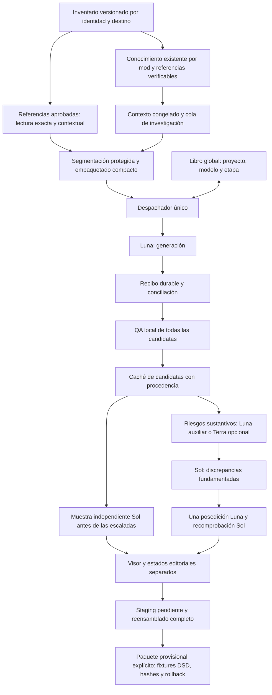

# Plan B: evolución implementada y validación offline

6 de noviembre de 2026 · Nolvus Awakening 6.0.21 · ES-419

**Resultado:** existe un nuevo flujo integrado con un despachador, un libro económico compartido, manifiestos versionados, cohortes, recuperación de recibos, memoria aprobada en solo lectura, caché de candidatas y revisión escalonada. Está conectado a staging y al visor existentes. La ruta pagada utiliza el transporte seguro anterior y exige un permiso nuevo; **no se ha habilitado ni ejecutado**. No se declara el producto listo para producción.

Esta entrega contiene implementación privada y pruebas, no otra propuesta de arquitectura. Las mejoras de calidad lingüística, la calibración del juez y la compatibilidad en juego siguen sin demostrarse. En esta fase hubo **cero solicitudes a proveedores de IA y cero créditos consumidos**. Las consultas web de documentación no son llamadas a modelos.

## 1. Arquitectura implementada

El diario no recorre el manifiesto completo en cada reclamación: los payloads se vinculan por hashes y los saldos se actualizan transaccionalmente. La conciliación completa se realiza al reabrir o comprobar el proyecto. Las solicitudes se identifican por su contenido y ámbito; una intención de envío queda grabada antes del transporte. Recibos, costes y aceptación de contenido son estados distintos.

Un fallo de formato con uso conocido queda aislado. Un timeout o uso anómalo mantiene la reserva y nunca provoca reenvío automático. La política de incertidumbre permite continuar trabajos independientes únicamente dentro del límite global. Un recibo de proveedor reutilizado entre dos solicitudes conserva el cuerpo y activa una parada global. Un rechazo con prueba explícita de no haber llegado a HTTP libera su reserva, sin reintentarlo automáticamente.

## 2. Código conservado, sustituido y compatibilidad

| Decisión | Implementación |
|---|---|
| Conservar | Parsers, `VariableProtector`, contrato compacto, QA y coherencia existentes, glosario contextual, TM, `ModKnowledge`, importador protegido, visor y exportadores anteriores. |
| Sustituir en el modo Plan B | Orquestación por piloto y presupuestos separados, comparación completa del plan por solicitud y selección fija del 2 %/14 casos. Se usan `MassWorkflow`, `Dispatcher` y `ProjectLedger`. |
| Separar | TM aprobada consultada de forma inmutable y exacta; caché de candidatas ligada a fuente/contexto/prompt/modelo. Las propuestas no se convierten en glosario o TM maestra. |
| Integrar | CLI `mass prepare/status/simulate/review`; botón «Abrir revisión Plan B» en la pestaña de revisión. |
| Mantener para reversión | Ejecutores, lectores, ramas, diarios y resultados históricos. No se borraron ni se migraron. Los límites del 2 %/14 siguen describiendo el ejecutor legado, no el modo nuevo. |

El modo histórico de la GUI no cambia automáticamente de base o proveedor. Plan B usa un proyecto aislado elegido explícitamente. El backend pagado no carga credenciales por presencia de variables: requiere API Lock desactivado en un trabajador posteriormente autorizado, un permiso con caducidad, hash del manifiesto, identidad del libro, hash de sus caps, modelos y número máximo de solicitudes. No se generó ningún permiso operativo ni un lanzador que desbloquee la API.

## 3. Luna, Terra y Sol: función y economía

Los validadores locales se aplican a todas las candidatas: identidad, cardinalidad, JSON estricto, controles, variables, texto vacío, terminología aplicable y referencias de coherencia. Las advertencias informativas no bastan para enviar un caso a evaluación por riesgo.

La selección deriva capacidades del presupuesto y del tamaño de las solicitudes; conserva una muestra estratificada y evita repetir una familia narrativa en esa muestra. **Los controles independientes de todas las cohortes preceden a las escaladas y correcciones**, para que el riesgo no agote primero los fondos de Sol. Se informan muestras no cubiertas y trabajo diferido. La asignación de selección orienta la planificación; los límites duros efectivos son los del libro por proyecto, modelo y etapa.

- **Luna:** traducción, triage auxiliar opcional y posedición. Evaluar con el mismo modelo comparte sesgos; su acuerdo no aprueba una traducción.
- **Terra:** alternativa auxiliar implementada mediante un perfil explícito, sin ampliar el router legado. Su tarifa es la mitad de Sol y diez veces la de Luna para iguales tokens. No existe evidencia local de que sea mejor juez de ES-419 o lore; no se activa automáticamente.
- **Sol:** muestra independiente y discrepancias sustantivas con evidencia. Se descartan preferencias estilísticas como fundamento de una corrección. Los fragmentos deben corresponder a fuente/destino; esta comprobación vincula la evidencia, pero no demuestra que el diagnóstico sea verdadero.
- **Corrección:** una propuesta Luna y una recomprobación Sol como máximo por diagnóstico vinculado. Se conserva la candidata original. Un resultado favorable permanece como revisión de máquina, no aprobación humana.

Tarifas Standard por millón de tokens: Luna US$0,10/0,50; Terra US$1/5; Sol US$2/10, entrada/salida. Fuentes oficiales: [Luna](https://developers.openai.com/api/docs/models/gpt-6-luna), [Terra](https://developers.openai.com/api/docs/models/gpt-6.1-terra), [Sol](https://developers.openai.com/api/docs/models/gpt-6.1-sol). No son presupuestos aprobados.

Gemini, Google Translation, DeepL, TranslateGemma local y TMS siguen siendo comparadores del [estudio previo](https://github.com/DanielLopezzz/Antigravity-MD-Skyrim/blob/main/Fase10_Evolucion_Linguistica/StrategicEvaluation_20261106/README.md), no dependencias nuevas: no hay un contraste natural que justifique añadir otro proveedor o un runtime GPU. Se implementó el punto de intercambio y la contabilidad por modelo; no se atribuye a esas alternativas una calidad o autonomía no medida.

Las reservas cuentan el sobre completo serializado, una holgura de framing, la salida máxima y un margen del 15 %, contemplando escrituras de caché de 30 minutos. La contabilidad usa microdólares redondeados hacia arriba y conserva tokens/recibos originales.

Se implementaron prefijos estables y controles de [Prompt Caching](https://developers.openai.com/api/docs/guides/prompt-caching), sin dar por supuesto un acierto. La caché de respuestas local y la caché facturada de prefijos son mecanismos distintos. El descuento solo entra en contabilidad cuando lo demuestra la telemetría.

El ciclo [Batch](https://developers.openai.com/api/docs/guides/batch) tiene preparación JSONL, IDs estables, límites de archivo, envío simulado durable, resultados parciales/desordenados y cierre por expiración/cancelación. Los recibos pasan por el mismo despachador y QA. Un resultado ausente retiene reserva: cancelar no demuestra coste cero. Una solicitud individual no puede obtener el descuento por una etiqueta. No se acumulan descuentos Batch/caché sin verificación. **Subida/polling reales de Batch permanecen deshabilitados**; todavía no justifican ampliar el alcance de red antes del piloto.

## 4. Contexto, conocimiento y consistencia

El nuevo flujo utiliza el índice existente en modo de lectura, prioriza referencias estructurales y congela lo recuperado antes de llamar al proveedor. Aplica términos aprobados por ámbito y variantes, y retiene conflictos. Fuente idéntica entre dos registros no equivale a identidad semántica.

La TM de referencia se consulta con texto exacto, firma contextual, procedencia propia, revisor y exclusión de simulaciones; las versiones conocidas incompatibles no se reutilizan. Se revalida contra terminología/contexto actuales. El archivo maestro conserva su hash antes y después de la lectura. Las coincidencias no se escriben ni se promueven automáticamente.

Para libros se reutilizan anclas protegidas y se conserva contexto vecino. Un párrafo que no cabe se retiene; no se corta o trunca arbitrariamente. La exportación de un padre exige reensamblado completo y validación del texto íntegro.

La falta de hablante/documentación produce una cola de investigación antes de declararse una necesidad humana. Esto **no significa que la aplicación ya haya investigado todas las páginas de autores**. La recuperación local funciona; fuentes externas pendientes de versión, acceso o licencia conservan ese estado. No se inventan biografías ni denominaciones.

Se contrastaron las capacidades documentadas de [xTranslator](https://github.com/MGuffin/xTranslator/blob/main/README.md) y [DSD](https://github.com/SkyHorizon3/SSE-Dynamic-String-Distributor). Los mapas NPC/diálogo y exportaciones de xEdit son entradas candidatas; no se presenta como implementado un importador universal ni un mapa de hablantes que no se haya obtenido. Se evita reconstruir un parser externo sin un intercambio real que permita probarlo.

## 5. Pruebas y comparación

Código privado: commit `25c3297`, rama `codex/plan-b-localization-20261106`. Suite final **383/383**, con **51 regresiones nuevas**; comprobación de whitespace del diff aprobada.

| Evidencia | Resultado | Alcance |
|---|---:|---|
| Inventario natural en planificación | 235,301 fuentes exactas; 240,523 unidades tras segmentar | Snapshot existente, sin escaneo nuevo ni modelos |
| Solicitudes preparadas / cohortes | 23,630 / 243 | Media 10.173 unidades por solicitud |
| Retenciones explícitas | 127 unidades; 1,083,232 caracteres | **5,40 % de los caracteres**; no equivalen a errores de traducción |
| Sobre completo preparado | 80,596,958 bytes UTF-8 acumulados | Contrato compacto, sin contexto autoral adicional en este benchmark |
| Planificación instrumentada | 342.909 s; 1157.23 MiB trazados | Incluye comprobación de sobres; no es velocidad API ni RSS total |
| Carga sintética | 1.000 entradas, 40 intercambios; 36 lotes válidos y 900 candidatas | Dos fallos QA y dos usos/envíos inciertos aislados |
| Reanudación sintética | 0 intercambios adicionales; saldos conciliados | Los costes de fixtures son virtuales |
| Integridad protegida | 71/71 archivos fuera de src/tests idénticos | Incluye bases, históricos y reserva incierta; tres archivos fuente base cambiaron con autorización |
| Proveedores reales / promoción | 0 solicitudes / 0 aprobaciones nuevas | El test positivo del puerto pagado usa permiso, credenciales y HTTP ficticios con sockets bloqueados |

En 5.000 fuentes naturales, las medianas de tres repeticiones fueron **12,730 s / 12,221 s / 10,492 s** para cohortes 500/1.000/2.000; las nueve preparaciones dieron 946 solicitudes. El menor tiempo observado fue con 2.000; se conserva 1.000 como compromiso operativo de seguimiento. No se ha medido el óptimo bajo latencia/API real, y estas diferencias no certifican una mejora general de velocidad.

[BENCHMARK.json](BENCHMARK.json), [SIMULACION.json](SIMULACION.json) y [VERIFICACION.json](VERIFICACION.json) permiten verificar los agregados sin publicar corpus o bases.

El contraste de lotes usa representantes por texto exacto del mismo inventario existente. El agrupador anterior estimaba 73.110 lotes, dejando fuera 69 textos grandes. El nuevo además segmenta y conserva las retenciones: no son dos ejecuciones facturables ni poblaciones de unidades idénticas. La comparación mide empaquetado, no una superioridad lingüística.

Se compararon cohortes de 500, 1.000 y 2.000 unidades sobre el mismo subconjunto natural, con repeticiones y caché local reiniciada. El tamaño no cambia por sí solo el número de HTTP: cambia la frecuencia de checkpoints y la extensión del aislamiento. Se mantiene **1.000 como valor operativo provisional**, no como óptimo universal demostrado. Para un mod pequeño basta una cohorte.

Las métricas de memoria se refieren a asignaciones Python durante la planificación; excluyen las filas ya cargadas y el intérprete/RSS. No se presentan como memoria máxima total del proceso. Los hashes de implementación acompañan el benchmark verificado.

No se midieron calidad/naturalidad ES-419, falsas aprobaciones, errores semánticos poblacionales o minutos humanos. Las referencias y controles sintéticos prueban contratos y errores sembrados, no calibración lingüística. Que no se creen aprobaciones nuevas no equivale a una tasa demostrada de falsas aprobaciones del 0 %.

## 6. Proyección actualizada para 240.684 cadenas

| Escenario estimado para 240.684 originales | Standard sin aciertos de caché | Extremo: toda entrada a escritura 1,25× |
|---|---:|---:|
| Generación Luna | US$17.98–18.67 | Se integra en los totales siguientes |
| Escalonado con Luna auxiliar | **US$23.74–24.43** | **US$26.37–27.23** |
| Mismo escenario con Terra auxiliar | US$31.11–31.79 | US$34.49–35.35 |
| Nueva generación, conservando la carga de revisión anterior del 2 % y corrección del 0,5 % | US$59.28–59.96 | US$65.57–66.43 |

El escalonado con Luna auxiliar corresponde aproximadamente a **US$0,099–0,102 por 1.000 originales**, sin escrituras de caché, impuestos ni trabajo humano. No es un precio garantizado ni una demostración de calidad equivalente al escenario anterior de US$71–79.

Hipótesis declaradas: 2.407 triages Luna por riesgos reales, 300 controles Sol independientes, 300 escaladas Sol y 121 correcciones/recomprobaciones. Son cantidades de un escenario económico, **no una cuota que el sistema aplique automáticamente ni una recomendación de cobertura ya calibrada**. Terra elevaría el coste de esos triages; su activación exigiría una mejora demostrada.

Para no ocultar las retenciones, se añaden 1.386 segmentos hipotéticos para sus caracteres, sin afirmar que su alineación esté resuelta. Además se supone un aumento del 50 % de solicitudes por contexto: **38.336** solicitudes de generación proyectadas, frente a las 23.630 medidas sin ese contexto adicional. Se usan 200 tokens de contexto por segmento, 600 tokens fijos por solicitud adicional, 64 de framing, 256 de razonamiento por solicitud y una conversión heurística de 3–4 bytes del sobre por token. El coste no procede de dividir bytes por tokens como si fuera una medición BPE.

Una mayor densidad contextual, más razonamiento, más correcciones o decisiones semánticas distintas pueden superar estos escenarios. Los límites del libro detienen trabajo sin elevar caps. No hay un nuevo presupuesto aprobado para toda Nolvus. [ECONOMIA.json](ECONOMIA.json) contiene fórmulas parametrizadas, cantidades y exclusiones; las retenciones y el contexto por identidad impiden tratar estos importes como un total cerrado.

Los cálculos parten de caracteres del inventario y bytes del sobre preparado; no multiplican el coste del piloto histórico. La tokenización estimada, razonamiento, contexto adicional, densidad de riesgos y correcciones siguen siendo supuestos. Se conserva el escenario de evaluación anterior como comparación y se separa el escenario económico escalonado, que tiene menos cobertura Sol y **no acredita calidad equivalente**. La TM productiva sigue sin aportar descuentos iniciales medidos.

## 7. Revisión humana y entrega provisional

Se distinguen referencia humana ya aprobada, candidata mecánicamente válida, revisada por IA, propuesta corregida y paquete experimental. El visor mantiene decisiones en un overlay privado. Una aprobación de Sol no se escribe como humana.

La entrega provisional exige permiso explícito por manifiesto, identificación de perfil clonado y una muestra humana vinculada a fuente/destino; rechaza riesgos locales abiertos, identidades incompletas, colisiones y formatos no cubiertos. Se crean hashes, manifiesto, backup y rollback en una carpeta de ensayo, sin instalar en MO2.

Cobertura nueva demostrada con fixtures: DSD JSON de campos `QUST FULL/CNAM`, `CELL FULL`, `WEAP FULL`, `ARMO FULL`, `SPEL FULL`, `BOOK DESC` e `INFO NAM1`, con checks de identidad y ruta. Esto no prueba todos los registros DSD ni su runtime. Los exportadores anteriores de tablas, MCM, PEX y otros formatos se conservan; no se les concede automáticamente entrega provisional sin revisión. No se probaron Nolvus, MO2, load order o partidas reales.

Sigue siendo necesario adjudicar una muestra natural independiente, resolver contradicciones de lore sin fuente y evaluar el paquete en un entorno clonado cuando se autorice. Como referencia de planificación, 300 casos a dos minutos serían diez horas, más investigación. **No es tiempo humano medido ni una cantidad suficiente garantizada para todos los mods.**

## 8. Riesgos y límites

La cobertura del inventario principal y las 240.684 cadenas históricas todavía requieren reconciliación por formato e identidad. No se descuenta dos veces la deduplicación ni las traducciones oficiales ya clasificadas. Contexto de autor parcial y hablantes desconocidos siguen limitando la fidelidad.

Luna/Sol pueden compartir errores; Terra tampoco es una referencia de verdad. La muestra estratificada y las familias reducen ciertas dependencias, pero no justifican aplicar sin más una confianza estadística poblacional. Las cohortes con presupuesto insuficiente quedan sin certificación, no «aprobadas por ausencia de incidencias».

El plan completo aún se materializa en memoria durante preparación. Se eliminó el recorrido completo por reclamación, pero no se promete memoria constante para toda la preparación. El hardware medido dispone de RAM suficiente para el ejercicio realizado; otros equipos requieren medir.

El perfil nuevo y su coste real no tienen confirmación de proveedor. El permiso pagado, las credenciales y el desbloqueo específico no forman parte de esta entrega. La reserva histórica incierta permanece intacta y no puede liberarse por lo que ocurra en un proyecto nuevo.

## 9. Procedimiento para un piloto de un mod completo

Se preparó **Amber Guard** en un proyecto privado nuevo: 146 registros del inventario, 128 traducibles, cinco pendientes de investigación, 12 nombres protegidos y un identificador. No se deduplican los 128 por texto para ocultar sus identidades. La versión exacta del autor todavía no está verificada. De las 128 entradas traducibles, 54 corresponden a los campos de entrega provisional probados y 74 a otros campos: el piloto de traducción puede abarcar todas, pero no se presenta un paquete provisional completo del mod como validado. Los cinco pendientes no se presentan como traducidos o resueltos.

La preparación final genera **16 solicitudes de traducción**, sin segmentos retenidos, con reserva máxima de generación **US$0,038404** bajo los límites preparados. Hay **32 tareas de contexto**, que no equivalen a 32 errores lingüísticos. El microdiagnóstico tiene tres solicitudes preparadas y reserva conjunta **US$0,013145**, dentro del cap propuesto US$0,05. Todos estos valores son preparación sin ejecución ni aprobación de gasto.

1. Completar procedencia/versiones y los cinco casos de investigación; revisar ubicaciones, familias y contexto disponible. Confirmar qué campos del mod cubre la entrega. Conservar originales y manifiesto.
2. Revisar la preparación offline del proyecto y los límites globales/modelo/etapa. El CLI no habilita HTTP: `mass prepare`, `status` y `simulate` usan datos locales y fixtures; `mass review` abre el visor aislado.
3. Autorizar específicamente un microdiagnóstico del **nuevo** perfil: dos Luna y un Sol, cap propuesto US$0,05, con cuerpos, reservas y procedimiento separados. No reabrir el diario histórico.
4. Si contrato, texto visible y uso son conciliables, autorizar un nuevo piloto sellado. El cap de US$0,30 mostrado en la preparación es **virtual/propuesto**, no heredado del piloto anterior. Sol seguirá selectivo; la ausencia de fondos para una etapa se informa.
5. Ejecutar desde el mismo flujo y libro en un trabajador autorizado. Interrumpir/reanudar y comparar IDs, recibos, costes, reensamblados y decisiones. No reenviar una solicitud incierta.
6. Adjudicar a ciegas muestras naturales y pasajes contiguos con referencias. Si la diferencia es inconclusa, no declarar éxito lingüístico ni elevar carga automáticamente.
7. Solo con permiso distinto para una prueba de entrega, generar paquete provisional de los campos cubiertos, inspeccionar hashes y probar en perfil clonado. No modificar el perfil de juego, Nolvus o las partidas por el mero éxito del piloto.

La preparación concreta y las evidencias privadas permanecen locales. GitHub recibe únicamente este informe, métricas agregadas y las cuatro páginas canónicas; nunca código, corpus, bases, credenciales o permisos operativos.
